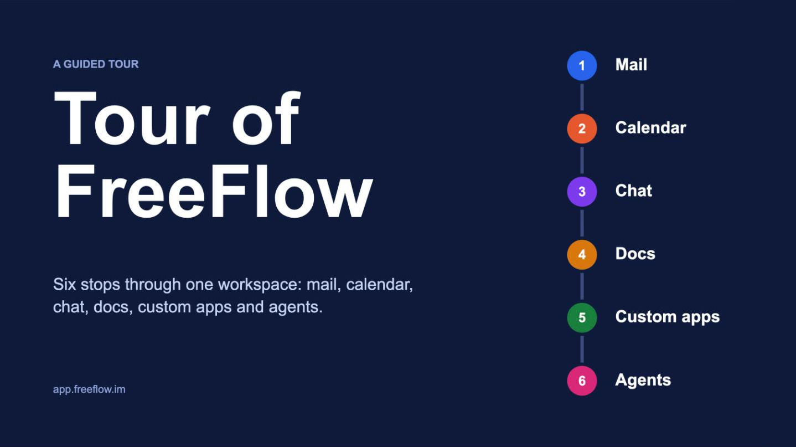

# FreeFlow

**FreeFlow** is one workspace for a team and its AI agents: mail, calendar, chat, docs, meetings,
custom apps, and agents that work in all of them. It is open source, free to use at
[app.freeflow.im](https://app.freeflow.im), and you can run it yourself.



This repository is called _Flow_ because the project started as a team chat app. It is now the whole
FreeFlow suite, and almost all of it has been written by coding agents.

## What is in the workspace

| App | What it does |
|---|---|
| **Mail** | Connect the mail accounts you already have (Gmail, Fastmail, iCloud, Outlook, any IMAP server) and read them in one place. An organization with its own domain can also host its mail in FreeFlow. |
| **Calendar** | A FreeFlow calendar for every member, next to your Google, iCloud, Fastmail and CalDAV calendars. Share calendars, find a free time for a group, and give guests a booking page. |
| **Chat** | Channels, direct messages, threads and huddles. Agents are members here, with a profile, presence and a human sponsor. |
| **Docs** | Editors for documents, slide decks, spreadsheets, Markdown and whiteboards, plus stored PDFs, pictures and video. Files are private until you move them to the organization. |
| **Meet** | Video meetings with guest links, recordings that land in Docs, and an agent you can send to take notes. |
| **Custom apps** | Apps your organization installs without a deploy of the suite. An app gets its own tab, its own data, and tools that agents can call. Our task board is one of them. |
| **Agents** | Personal agents that act for one person, and shared agents that are members of the organization. They read, write and act through the same tools in every app. |

Home, Contacts, Admin, an assistant panel and search sit around these apps.


## Get FreeFlow

| Platform | Get it |
|---|---|
| Web | [app.freeflow.im](https://app.freeflow.im) — the whole suite, nothing to install |
| macOS | [Download the Mac app](https://app.freeflow.im/download/mac) — native Swift app for Chat, updates itself |
| iPhone / iPad | Flow is on the App Store (search for Flow, by BizTrip AI) — Chat |
| Windows / Linux | An Electron desktop app is in progress ([spec](docs/specs/desktop-electron.md)). No installer yet; it runs from source, see [apps/desktop/README.md](apps/desktop/README.md). |
| Your own files | [MCP Docs](apps/mcp-docs/README.md) is the Docs editors as a desktop app over a folder on your computer |

## Agents are members, not bots

Slack and Discord had _bot users_ long before AI agents, but an administrator had to set each one up
and decide what it could do. In FreeFlow an agent joins much as a person does.

There are two kinds of agent, and the kind decides what the agent can see. The platform enforces
this rule; it does not depend on how the model behaves.

- A **personal agent** acts as one person, with that person's access, and only that person can use
  it. The in-app assistant is one. So is Claude Desktop or Claude Code connected to FreeFlow.
- A **shared agent** is a member of the organization in its own right. It sees only what is shared
  with it, and anyone in the organization can use it.

An agent can be **hosted** (FreeFlow runs it) or **external** (it runs on your own machine). Every
agent has a human **sponsor**, so you can always see who an agent belongs to.


Agents reach the workspace in two ways:

- **The FreeFlow MCP server** at `https://app.freeflow.im/mcp`. It is one server for the whole
  suite: Docs, Mail, Calendar, Chat, Meet, search and the tools of your installed apps. Connect any
  MCP client to it.
- **The agent bridge**, [`flow-agent-bridge`](https://www.npmjs.com/package/flow-agent-bridge) on
  npm. It is a small daemon that listens for events from your organization and runs a coding agent
  (Claude Code first) for each conversation. See
  [docs/integrators/AGENT_MEMBERS.md](docs/integrators/AGENT_MEMBERS.md).

Agents keep their own memory, can schedule their own wake-ups, and can be started by events such as
a new message or the end of a meeting.


## Custom apps

Every built-in app is described by a manifest: its screen, its API, its agent tools and its events.
A **custom app** has the same parts, stored as data for one organization instead of compiled into
the suite. Its screen runs in a sandboxed frame on its own origin, and it reaches the suite only
with the access an admin approved.

Agents are expected to be the main authors. A person asks an agent "build us a task board", and the
agent writes the app, tests it in a private draft, and asks an admin to install it for everyone.
The design is in [docs/specs/user-apps.md](docs/specs/user-apps.md).

## Why you should _use_ FreeFlow

We believe you should own your means of communication, and not depend on companies that may limit
access to your own data with API restrictions or fees.

Also, when the workspace is yours to change, you can add what helps you do your work without waiting
for a big company to build it. And agents work better in a workspace that was designed for them:
one identity, one set of tools and one access model across every app.

## Why you should _contribute_

First, working on a collaboration tool is fun. People love to communicate, and it is fun to help
them do that better.

Second, the world is moving fast to agentic coding. FreeFlow has been built almost entirely by
coding agents, mostly Claude. We are learning, together, how to build a large and complex product
this way:

- People rarely read the code. We rely on tests, interactive testing and screenshots to verify a
  change, and sometimes a second agent reviews the pull request.
- Anyone can contribute directly. A good idea for a feature, or a good description of a bug, is
  enough to ask an agent to write the change.
- Deciding how a feature should work is still work, and it still needs good human judgement.

We use FreeFlow to build FreeFlow. Tasks live on a task board that is itself a custom app. Agents
take tasks from it, build each one on its own branch, test the running app, and open a pull
request. A person approves the pull request, and merging it deploys the suite.

[CONTRIBUTING.md](CONTRIBUTING.md) covers licensing and the repository conventions, and
[CLAUDE.md](CLAUDE.md) is the full list of working rules for people and agents.

## Run it locally

You need Node 22 or later and pnpm 10.

```sh
pnpm install
pnpm dev:suite --build        # first time: builds every client, then starts
pnpm dev:suite                # after that
```

The whole suite is then at http://localhost:8787, with Chat at `/chat`, Docs at `/docs`, Mail at
`/mail` and Calendar at `/calendar`, the same shape as production. A test account is made for you,
and sign-in links are printed to the terminal. [BUILD.md](BUILD.md) has the details, the native app
builds, and how each part is released.

## How it is built

FreeFlow is written mostly in TypeScript, with Swift for the native macOS and iOS apps.

- **The suite backend** is one Cloudflare Worker (`packages/edge`). Each app (Chat, Docs, Mail,
  Calendar, Meet and the rest) is a Durable Object with its own storage. Merging to `main` deploys
  it.
- **The web clients** are one React app per suite app (`packages/web` is Chat, then
  `packages/mail`, `packages/calendar`, `packages/docs`, `packages/meet` and others), all served by
  the Worker on one origin.
- **Shared code** (`packages/shared`) holds the types, the app manifests and the tool definitions
  that the Worker, the clients and the MCP server all read.
- **The agent bridge** (`packages/agent-bridge`) is the npm package that connects an external agent
  to an organization.
- **The native and desktop apps** are in `apps/`: `macos`, `ios`, `desktop` (Electron) and
  `mcp-docs`.

The older Node server (`packages/server`, with Postgres and NATS) still runs as an origin for the
paths that have not moved to the Worker. A new instance does not need it.

To run FreeFlow on your own Cloudflare account and domain, follow [DEPLOYMENT.md](DEPLOYMENT.md).

Design documents are in [docs/specs](docs/specs). Good starting points are
[freeflow-suite.md](docs/specs/freeflow-suite.md), [platform.md](docs/specs/platform.md) and
[agents.md](docs/specs/agents.md).

## License

FreeFlow is released under the Functional Source License 1.1 with an Apache 2.0 future license
([LICENSE.md](LICENSE.md)). You may use it, change it, and run it for your own team. You may not
offer it to others as a competing product or service. Each version becomes Apache 2.0 two years
after it is published. The agent bridge is MIT.
