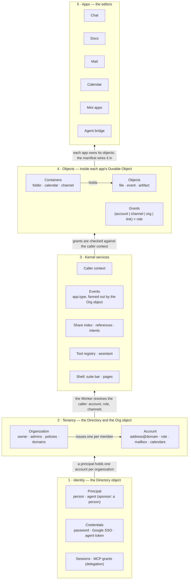
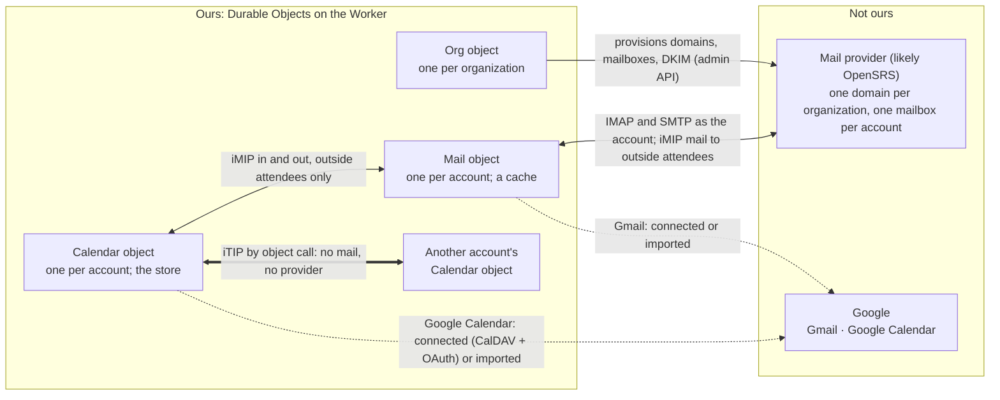

# FreeFlow platform: identity, accounts, objects, and the apps on top

Status: design proposal · 2026-11-06. Nothing in the repository changes by this document. The rulings in §10 go to
`decision_log.md` when Scott confirms them. The diagrams are `platform-layers.html` beside this file (open it in
a browser: the layer stack, one request end to end, and the platform's edges); the Mermaid figures in §0 are the
same pictures.

This document gathers three rounds of design discussion into one proposal: the platform the suite already is but has
not written down (§5, §6), organizations and sharing (§4), and a new identity model built for hosted email (§2, §3).
Where it contradicts `freeflow-suite.md`, `mail-api.md`, `calendar.md` or `cloudflare-migration.md`, this document
is the newer intent and §8 lists each reversal.

## 0. The picture

Read it from the bottom. Each layer serves the one above it and knows nothing about it.



The platform's edges, after the rulings of §3.5: mail is outsourced, calendars are ours.



## 1. What this replaces

- **One identity concept today.** The directory's `users` row is the login, the member, the mailbox owner and the
  calendar owner at once. Mail and Calendar objects are keyed by user id. With hosted email a person in two
  organizations has two addresses, two inboxes and two sets of calendars, so the person and the member split (§2, §3).
- **No hosted mail or calendars.** `mail-api.md` and `calendar.md` both say people connect accounts they already
  have. This proposal reverses that: the organization hosts both through an outside provider, and the external
  account becomes the secondary case.
- **Two sharing scopes.** Docs has private or organization-wide and nothing between. Chat shares by channel. Mail and
  Calendar share nothing. §4 gives every app one grant model.
- **Groups are dropped for now.** The earlier sharing round proposed groups inside an organization. The ruling is no
  groups in the first version; a channel's membership is the only "set of people" a grant can name.
- **The app recipe becomes a contract.** Calendar's spec says "built the way Mail was built" and lists about eight
  places to edit by hand. §6 makes that one manifest.

## 2. Layer 1: identity

Everything that must be found before an organization is known. It lives in the Directory object and stays small.

### 2.1 Principals

A principal is a person or an agent. It is how someone signs in and nothing more: no address, no inbox, no role.

| Column | Meaning |
| --- | --- |
| `id` | the principal's id, used everywhere below |
| `kind` | `person` or `agent` |
| `login_email` | a person's sign-in email, unique; may be a personal Gmail; **never an address anyone writes to** |
| `display_name` | the default name, which each account may override |
| `sponsor_id` | required for an agent: the person principal responsible for it; null for a person |
| `status` | `active`, `suspended`, `deleted` |

An agent's `login_email` is a synthetic unique value; agents never sign in by email.

### 2.2 Credentials

| Table | Who | What |
| --- | --- | --- |
| `passwords` | person | argon2id hash, one per principal |
| `oauth_identities` | person | provider + subject → principal (Google today; Apple on iOS) |
| `agent_tokens` | agent | hashed bearer tokens, revocable, the bridge's credential |
| `sessions` | person | token hash → principal, expiry, client |

Rules: a person signs in by password or SSO, and may have both. An agent signs in only by token. The sponsor must be
a person. An agent cannot sponsor an agent, own an organization, or hold the admin role.

### 2.3 Delegation

An MCP OAuth grant (`oauth_tokens` and its neighbours, already in the directory) lets a client act **as a person's
account**: the consent page already chooses the organization, so the grant carries an `account_id` and scopes. This is
different from an agent acting as itself with an agent token. Both exist and the docs name them apart:

- **Agent member**: its own principal, its own accounts, its own token. Sees what is shared with it.
- **Delegation**: a grant on a person's account, limited by scopes. Sees what the person sees.

## 3. Layer 2: organizations and accounts

### 3.1 Organizations

Any signed-in person may create an organization and becomes its **owner**. Roles are `owner`, `admin`, `member`.
The owner may transfer ownership and promote admins. Admins invite, remove, suspend, manage domains and policies.

Policies, all in one JSON column, and few: who may invite (admins or every member); whether SSO on a verified domain
joins automatically (today's `organization_domains` rule); whether members may sponsor agents; whether link sharing
is allowed.

The directory holds the organization row, its slugs and domains. The Org object holds everything else about it.

### 3.2 Domains and addresses

- An organization registers one or more domains and verifies each with a DNS record. One is primary. An
  organization with no domain of its own gets `<slug>.freeflow.im`.
- A domain belongs to one organization. An address is therefore unique across the platform.
- The directory keeps `addresses (address → account_id)`. Inbound mail routing, invitation delivery and the
  address completer resolve through it.
- A login email and an address may be the same string, as when the organization runs Google Workspace on its domain
  and the person signs in with Google. They stay two columns: one is a credential, the other a name.

### 3.3 Accounts

The new thing. One per principal per organization; today's `memberships` row with an id, an address and a state.

| Column | Meaning |
| --- | --- |
| `id` | the account id; **Mail and Calendar objects are keyed by it** |
| `principal_id` | who holds it |
| `organization_id` | where |
| `address` | `local@domain`, the account's name inside the organization, unique |
| `display_name` | what members see; defaults from the principal |
| `role` | `owner`, `admin`, `member` |
| `kind` | `native` (has a mailbox) in v1; `guest` reserved for later |
| `state` | the provisioning state (§3.4), then `active`, `suspended`, `removed` |

Everything the organization gives a member hangs off the account: the mailbox, the calendars, the role, the profile.
When a person leaves, the organization keeps the account's mailbox and calendars under its own policy and the person
keeps their login. That split is the reason for the layer.

**Agent accounts** follow three rules. (1) An agent may hold an account only in an organization where its sponsor
holds one. (2) When the sponsor's account is suspended or removed, the agent's accounts there follow. (3) The agent's
account is otherwise a full account: `builder@acme.com`, a mailbox, calendars. Inviting it to a meeting is an
ordinary attendee line; mailing it is ordinary mail. Every surface that shows the agent shows "sponsored by".

### 3.4 Provisioning

An account's state machine, run from the Org object on an alarm with retries:

`requested → mailbox_ready → calendars_ready → active` · `suspended` · `removed`

Chat and Docs work from `requested`; Mail and Calendar show "being set up" until `active`. The mailbox credential is
created by the platform at `mailbox_ready` and sealed with the data key in the account's Mail object, the same sealing
the object does today for user-entered passwords. On `removed`, the mailbox is suspended at the provider and kept for
the organization's retention period, then deleted.

### 3.5 Mail is outsourced; calendars are ours

The platform does not run a mail server. Mailboxes come from a hosted provider through its admin API. Calendars are
the platform's own: the Calendar object is the store, not a cache of someone else's server, and scheduling between
accounts is a call between two of our objects.

#### Mail: a hosted provider, likely OpenSRS

Three requirements on the provider (the calendar requirement of the earlier draft is gone, since calendars are ours):

1. An admin API to create, suspend and delete mailboxes and set their credentials.
2. IMAP (or JMAP) and SMTP submission per mailbox, so the Mail object's existing drivers apply.
3. Custom domains with DKIM through the API, and the MX, SPF and DMARC records to show the organization's admin.

**OpenSRS Hosted Email** (Tucows) meets all three, checked 2026-11-06 from its documentation: the OpenSRS Mail API
(JSON over HTTPS at `admin.a.hostedemail.com/api`, a company or domain administrator's credentials) with
`change_domain` and `change_user` (`create_only` to create; `type: mailbox`, `password`, `quota`, `aliases`; service
switches `service_imap4`, `service_smtprelay`, `service_webmail` set to enabled, disabled or suspended), `get_user`
and `delete_user`; IMAP and SMTP per mailbox; DKIM by `change_domain` with `dkim_selector` and `dkim_key` (the
platform generates the key pair and keeps the private key, since OpenSRS cannot return it; 1024-bit on OpenSRS's own
nameservers). Limits to carry into the account model: 2,000 aliases per mailbox, at most 10,000 sends a day per
domain, no catch-all on new domains. Each organization is a domain under one FreeFlow company at OpenSRS;
`<slug>.freeflow.im` subdomains are domains there too. The organization's provider ids and the admin credential live
in the organization's row, sealed.

The platform sets every mailbox password itself at `mailbox_ready` and seals it in the account's Mail object. People
never see it; they use FreeFlow Mail. The provider's webmail is switched off per domain.

#### Calendars: native calendars inside the existing Calendar object

Calendar shipped on 2026-11-04 to 06 (PRs #704 to #712, `packages/calendar`, `packages/edge/src/calendar/`): one
object per person holding **connected** calendars (CalDAV with iCloud and Fastmail presets, Google with OAuth), a
complete copy kept fresh by an alarm, the client with FullCalendar, invitations across Mail and Calendar with iMIP
(`imip.ts`, `invites.ts`), the eight tools on `/mcp` and in the assistant. All of that stays. What this proposal adds
is a **native** calendar kind beside the connected ones: calendars whose store is the object itself, scheduled
between accounts by object calls. Connected calendars remain the secondary path, as external mailboxes are for Mail.

- **The object is the store for native calendars.** A native calendar has no sync alarm and no etag against another
  server; a write is a transaction in the object and an event on the bus. The CalDAV and Google drivers keep serving
  the connected calendars as built.
- **Scheduling between accounts is ours.** An attendee's address resolves through the directory's `addresses` table
  to an account; the organizer's Calendar object delivers the iTIP REQUEST to that account's Calendar object by
  binding (`CALENDAR.get(idFromName(accountId))`), which puts the event on the attendee's default calendar with
  `needs-action` and publishes `calendar.invited`. REPLY, CANCEL and updates travel the same way. Only the organizer's
  object may change an event; an attendee's object may only set its own status. This is RFC 6638's behaviour with the
  transport replaced by an object call, and it is what makes an agent invitation identical to a person's.
- **External attendees get iMIP by mail.** The organizer's Calendar object asks the account's Mail object to send the
  invitation (`text/calendar; method=REQUEST`) from the account's mailbox over SMTP. Inbound: the Mail object
  recognises a `text/calendar` part in the account's inbox and hands it to the Calendar object
  (`POST /v1/calendar/invites`, as `calendar.md` §4 already defines), which applies it if the sender is the
  organizer on record. Replies from external attendees come back the same way.
- **Free/busy needs no provider.** `find_free_time` reads the attendees' Calendar objects directly, subject to grants
  (§4): an attendee's busy intervals are visible to any member of the same organization; details only with a grant.
- **CalDAV for outside clients is optional and later.** Apple Calendar or Thunderbird would need a CalDAV server on
  the Worker over the object: PROPFIND, REPORT (`calendar-query`, `calendar-multiget`, `sync-collection`), PUT with
  If-Match, DELETE. `calendar.md` §2.3 already judged that subset small enough to write. It is not in the first
  version; the suite's own client and the tools are.
- **Libraries, not a server.** `ical.js` for parsing, serialising, time zones and recurrence expansion (already
  chosen). The iTIP state machine (which method may change what, sequence and DTSTAMP rules) is a few hundred lines
  written here, with tests from RFC 5546's examples. No calendar server, no Stalwart, no SOGo.

#### Google data: connected or imported

Gmail and Google Calendar stay supported as a secondary path, two ways:

- **Connected, kept in sync.** Gmail is a second account under the person's Mail object, as connected accounts work
  today (IMAP and SMTP with an app password, or XOAUTH2 with a Google refresh token). A Google calendar is a calendar
  row with `source: google` in the Calendar object, filled by the CalDAV driver with an OAuth credential (or Google's
  REST API), refreshed by the alarm, shown overlaid beside the account's own calendars; writes pass through to Google,
  and scheduling on it is Google's. Shareable inside the organization as viewer only.
- **Imported once.** Messages copied from Gmail into the hosted mailbox over IMAP, or events copied from a Google
  calendar into one of ours; after that the data is the platform's and Google is not involved. The migration path.

Both need a Google refresh token, which the suite does not hold yet: an auth-code flow on the Worker,
`GOOGLE_CLIENT_SECRET` used at last, the token sealed in the account's object. The calendar scope is "sensitive" at
Google, so until the OAuth app is verified only listed test users can connect (`calendar.md` §2.2).

Consequences: `calendar.md` §1's non-goals "no hosted calendars" and "no shared organization calendars" are reversed;
§2.1 (one object per person) becomes one per account; the drivers, cache and sync of §2.2 to §2.4 stay for connected
calendars; the invite card in Mail (§6) stays as built. `mail-api.md`'s "no hosted mailboxes" is reversed by the
provider path above.

### 3.6 The caller context

On every request the Worker resolves, once: the principal (from the session, agent token or MCP grant), the account in
the organization the request names (`?workspace=` today), its role and state, and the ids of the channels it belongs
to. It passes that **caller context** to the app object. App objects never call the directory to authorize.

A per-person object becomes a **per-account object**: `idFromName(accountId)`. Switching organizations in the bar
switches the inbox and the calendars. An external mailbox a person connects by hand attaches to the account of the
organization they connected it in.

## 4. Layer 3: objects, containers and grants

### 4.1 References

Every object an app owns is named by a reference: `organization / app / kind / id`. A reference is what a grant
names, what the share index stores, what a chip or an unfurl renders, and what an intent (§5.3) carries.

### 4.2 Containers

Objects sit in containers: a file in a folder, an event in a calendar, an artifact or message in a channel. Access
inherits down the container chain unless an object has grants of its own. This keeps grant lists short and matches
what people expect from Drive. Each app declares its container kinds in its manifest.

### 4.3 Grants

A grant is one row in the owning app's object:

`grants (object_kind, object_id, principal, role, granted_by, granted_at, expires_at)`

Principals a grant may name, all within one organization:

| Principal | Meaning |
| --- | --- |
| `account:<id>` | one member, person or agent |
| `channel:<id>` | the channel's members, as a set; the channel gets a card saying what was shared |
| `org` | every member of the organization |
| `link:<token>` | anyone with the link, with an optional expiry; replaces Docs' public links |

Groups are not in the first version. The principal column is a string so they can be added without a migration.

Roles are the same everywhere; each app maps them to its own actions:

| Role | Can |
| --- | --- |
| `viewer` | read |
| `editor` | read and change |
| `manager` | editor, plus change sharing |
| `owner` | manager, plus delete and transfer; the creator by default, as a column, not a grant |

A private object has no grants. Today's "Organization files" is one grant, `org` as editor, on the root folder, so the
migration from Docs' `private` flag is mechanical.

### 4.4 Where grants are evaluated

In the app object, with one shared library (`@flow/shared` grants: the table, the resolve function, the role names).
The effective role is the highest of: the owner column, the object's own grants, the container chain's grants, each
matched against the caller context's account id, channel ids and the organization. No call leaves the object.

Per-account objects accept callers other than their owner. Ann's calendar lives in Ann's Calendar object; when she
shares it with `#sales`, a reader's request goes to Ann's object with the reader's caller context, and Ann's object
checks the grant. Mail is not shareable; sharing a message is copying it into Chat or Docs, which exists.

### 4.5 The share index

Every grant change is reported to the Org object through the outbox pattern the Org object already uses to report
agent tokens to the directory. The Org object keeps `shares (reference, principal, role, granted_by, at)` and answers
"shared with me", feeds search, and resolves references into chips. Without it, "shared with me" would be a fan-out
over every app object.

### 4.6 Events

`sharing.granted` and `sharing.revoked` are the first app-wide events (§5.2). They feed the share index, the
notification row ("Ann shared Q4 plan with you"), the channel card, and open clients.

## 5. Layer 4: kernel services

Five services every app uses and none owns.

### 5.1 Caller context

§3.6. Resolved by the Worker, passed to the object, the only input to authorization.

### 5.2 The event bus

**Today.** An event is `{type, workspaceId, channelId?, ts, data}` with about 28 Chat-only types in `shared/events.ts`.
A service calls `publishEvent(subject, event)` inside a request and the Org object's `broadcast` sends the frame to
its hibernating sockets with one rule: a user subject to that user, a private channel's event to its members, the
rest to every socket in the organization. Nothing is stored, nothing is acknowledged, and a socket that is down
misses the event. The bridge drops most events and runs a turn only for a DM, an @-mention, a reply in a thread it
is in, a message in a channel it created, or anything under `eventScope: all`; those rules are code in the bridge.
Mail and Calendar emit nothing and poll. The only timed trigger is a scheduled message that mentions an agent.

**The bus is a logical event stream, separate from the sockets.** The socket stays the transport for the live UI;
the bus is where events are kept and read.

- **One event log per organization, in its own Durable Object** (`Events`, `idFromName(organizationId)`). Every
  app object publishes into it by binding, the Org object included, so publishing is one code path for every app,
  consumers waiting on the log do not contend with chat, and the log has its own size budget. The log is append-only:
  `events (seq, id, type, actor, ref, channel_id, caused_by, depth, ts, data)` with `seq` monotonic within the
  organization. Retention is a window (30 days, or a row cap). Events are immutable; a correction is a new event.
  Presence and typing are not events: they stay on the sockets and are never replayed.
- **The envelope** is `{id, seq, type: '<app>.<type>', organizationId, actor: accountId, ref?: reference,
  channelId?, causedBy?: jobId, depth, ts, data}`. Each app declares its types in its manifest. Per-account objects
  (Mail, Calendar, the assistant) publish into their account's organization.
- **Subscriptions are durable consumers with a cursor.** `subscriptions (id, name, consumer: accountId, owner:
  accountId, filter, delivery, cursor, created_by, created_at, parked_at)` in the Events object. The queue is not a
  copy of events: it is every event after the cursor that matches the filter and that the consumer may see, read
  from the log at request time. Visibility is evaluated at read time from the share index (§4.5) and channel
  membership, so a revoked grant stops delivery on the next read. Acknowledging advances the cursor, cumulatively
  and in order. A consumer away longer than retention gets `gap: {from, to}` and its cursor moves to the window's
  start. `filter` names any of: type patterns (`calendar.*`, `chat.message.created`), a reference or container, a
  channel, an actor kind (person, agent, any), a text match, and `self: true` for events about the consumer's own
  objects. "Every item added to my calendar" is `{types: ['calendar.event.added'], self: true}`.
- **Reading is HTTP and works at any time**, with the same four operations as tools in the registry (§5.4), so the
  bridge, `/mcp` and the assistant read a queue the same way:

  ```
  POST /v1/events/subscriptions              { name, filter, delivery? }     → { id, cursor }
  GET  /v1/events/subscriptions/:id?limit=100&wait=30                        → { events, next, gap? }
  POST /v1/events/subscriptions/:id/ack      { cursor }                      → { ok }
  GET  /v1/events?since=<seq>&types=&ref=                                    → one-shot read, no subscription
  ```

  `wait` long-polls: the object holds the request until an event matches or the time runs out, so a connected
  consumer gets events at once without a socket. A read never acks; a crash between read and ack redelivers.
- **Delivery modes** are options on a subscription, not different systems:

  | Mode | On a match |
  | --- | --- |
  | `pull` | nothing; the consumer reads when it likes |
  | `socket` | the consumer's open socket gets a poke naming the subscription; it reads and acks over HTTP |
  | `webhook` | the object POSTs the event to a URL with an HMAC signature, retries with backoff, parks the subscription after repeated failure and notifies the owner |
  | `wake` | a job row is created for the agent (`agent_jobs (id, subscription_id, agent, event_id, prompt, state, attempts, lease_until)`), delivered as an `agent.job` event on the agent's own subscription; the bridge acks it, runs the turn where the subscription says, and reports done or failed; a lapsed lease retries, three failures park it |

  A trigger is a subscription with an action. People create them in an **Automations** page and from any object's
  menu ("When this changes…"); agents create them with a tool under a scope; the bridge creates its mention, DM and
  thread subscriptions at join, so today's behaviour is expressed on the one path. Schedules are subscriptions on
  `schedule.tick`, which the Events object's alarm publishes for each due schedule; a scheduled message is one with
  a post action. The bridge's `start_task` becomes a job one agent files for another.
- **The UI socket is a consumer too.** A client's `auth` frame carries `since: seq`; the Org object answers with the
  backlog the client may see, read from the Events object, then live events as now. After a reconnect nothing is
  lost and nothing is refetched.
- **Loop safety on the server.** An event caused by a job carries `causedBy` and `depth + 1`. A subscription ignores
  events its own consumer caused unless it opts in, and the organization has a depth cap (default 4) past which no
  wake fires and the owner is told. This replaces the bridge's `agentChainLimit`.
- **Guarantees.** At least once. In order within one organization. An agent in three organizations has three
  subscriptions. Reads are bounded (`limit` ≤ 500) and cheap: one indexed range scan on `(seq)` with the filter in
  SQL and visibility applied per row.

The mechanism is Figure 4 of `platform-layers.html`: publishers on the left, the log and its subscriptions in the
Events object, consumers on the right reading by cursor.

**Why not Cloudflare Queues for the bus.** Queues is a work queue: a message is consumed once by competing consumers,
is gone once acknowledged, is not delivered in order, and retention is at most 14 days. The bus needs many readers of
the same event each with their own cursor, history a new subscription can start from, order within an organization,
and visibility checked at read time. A log in SQLite with a cursor per subscription gives all four. Queues does fit
the deliveries that are "keep trying until done": webhook posts, agent wake jobs, APNs pushes and the provisioning
steps against the mail provider, each today a table drained by an object's alarm. Those move to a Queue with a
dead-letter queue when they are built; the log stays the source of truth and the Queue is the retrying courier.

The first events beyond Chat: `sharing.granted`, `sharing.revoked`, `calendar.event.added`, `calendar.event.updated`,
`calendar.event.cancelled`, `calendar.invited`, `mail.received` (from the Mail object's alarm, for the account's own
inbox), `docs.changed`, `schedule.tick`, `agent.job`. A subscription on Ann's mail that wakes Builder gives Builder the
reference, not the message; reading the body needs a grant or a delegation like anything else.

### 5.3 References and intents

A reference (§4.1) renders the same everywhere: the app's manifest gives a resolver (name, icon, url, a one-line
summary) and the shell draws the chip or the unfurl. An intent is a small verb an app can ask of another: `open`,
`create`, `share`. "Create event from this thread" in Mail is an intent to Calendar with a reference, not a hand-built
URL. The current pairwise wiring (`/calendar?new=`, `/?open=`, the Calendar ↔ Mail object bindings) becomes this.

### 5.4 Tool registry

Each app registers its tools and scopes once (as `mailTools.ts` and the planned `CALENDAR_TOOLS` already do). The
registry serves three doors with one list: `/mcp` (delegation, filtered by the grant's scopes), the bridge's MCP (an
agent member, filtered by what its account can see) and the in-app assistant (the person, with page context). The
OAuth consent page's scope groups come from the registry, not a hand-edited list.

Tools are of two kinds, and the registry marks each. **Server tools** run in the app's object and go through every
door. **Browser tools** run in the open editor against what is on screen (insert into this document, open this
message) so the change is undoable; they exist only for the live assistant, and the other two doors never list
them. Today the three doors keep their lists by hand: `/mcp` serves the Docs plugin's tools and the Mail tools, the
assistant has its own server and browser tools with a few Mail tools imported, and the bridge's MCP has Chat's.

### 5.5 The assistant

Today the suite assistant is a Docs feature and Mail stores its chat inside the Docs object. It becomes a kernel
service: its own object per account, holding chats, reading tools from the registry and page context from whichever
app is open. Docs becomes one more app that registers a context and tools.

### 5.6 The shell

The suite bar's tabs, the Worker's page routes, the asset assembler and the OAuth scope groups all read the list of
manifests instead of four hand-edited files.

## 6. Layer 5: apps

### 6.1 The manifest

One declaration per app:

| Field | Example |
| --- | --- |
| `name`, `path` | `calendar`, `/calendar` |
| `scope` | `organization` (one object per organization) or `account` (one per account) |
| `object` | the Durable Object class and its migration tag |
| `routes` | the Hono module under `/v1/<name>` |
| `kinds` | object and container kinds it owns, with a reference resolver for each |
| `tools` | tool definitions and the scopes that gate them |
| `assistant` | the page context it provides and the browser tools it runs |
| `tab` | the suite-bar entry: label, shortcut, badge source |
| `client` | the Vite build folder and base path |
| `events` | the event types it publishes into the organization's log |

The manifest is also the spec a factory agent follows to add an app.

### 6.2 The apps as they map

| App | Scope | Containers → objects | Shareable | Change from today |
| --- | --- | --- | --- | --- |
| Chat | organization | channel → message, artifact, file | by channel membership (unchanged) | channels become grant principals |
| Docs | organization | folder → file, sheet, deck, doc | yes, grants | `private` flag → grants; Share dialog; "Shared with me" |
| Mail | account | mailbox (hosted) → folder → message | no | keyed by account; provisioned, not connected |
| Calendar | account | calendar → event | yes, calendars | keyed by account; native calendars stored and scheduled here beside the connected ones; shared calendars (reverses a v1 non-goal) |
| Mini apps | organization | artifact (link) | by channel (unchanged) | later: tools, events, a scoped token |

### 6.3 Clients

The platform is web first. The native apps know Chat only; each new tab is a web view or a Parity entry. The agent
bridge is an app too: it holds an agent token, learns the agent's accounts, subscribes to events by namespace and
uses the registry's tools.

## 7. One request, end to end

Ann invites her team's agent to Thursday's review.

1. **Apps.** Ann, in Calendar, adds `builder@acme.com` as an attendee and saves.
2. **Kernel.** The Worker resolves her session: principal Ann → account `ann@acme.com` in Acme, role member, her
   channel ids. The caller context goes to her Calendar object.
3. **Objects.** Her Calendar object checks she is the calendar's owner and stores the event in its own SQLite, in
   one transaction with the scheduling it starts next.
4. **Objects.** Her Calendar object resolves `builder@acme.com` through the directory to Builder's account and
   delivers the invitation to Builder's Calendar object by binding. No mail is sent: both calendars are the
   platform's own. An attendee outside the platform would get iMIP mail from Ann's mailbox instead.
5. **Kernel.** Builder's Calendar object stores the event with `needs-action` and publishes `calendar.invited` into
   Acme's Org object.
6. **Kernel.** The Org object fans the event out to Builder's bridge socket.
7. **Identity.** The bridge wakes the agent. With its own agent token the agent calls `get_event` and
   `respond_to_event`. Ann's view shows "accepted".

Nothing in the path is agent-specific. Replace Builder with a person and only step 6 changes: a notification instead
of a bridge socket.

## 8. What changes, per package

- `packages/edge/src/directory`: `users` → `principals` + `credentials`; `memberships` → `accounts` with address and
  state; `addresses`; `organizations` gains owner and policies; MCP grants carry `account_id`.
- `packages/edge/src/org`: member profiles become account profiles; the `shares` index; the provisioning alarm; the
  socket fan-out reads its backlog from the Events object.
- A new `Events` object per organization (`packages/edge/src/events/`): the log, subscriptions, long-poll reads,
  webhook and wake delivery, the schedule alarm; `wrangler.toml` gains the binding and a migration tag.
- `packages/edge/src/imap` (Mail) and the planned `src/calendar`: keyed by account id; a provisioned hosted mailbox
  beside connected ones; Calendar is the store, accepts other callers, evaluates grants, and schedules.
- `packages/edge/src/docs`: `private` → grants; `publicLinks` → `link:` grants; a Share dialog; "Shared with me".
- `packages/shared`: `grants` library, `references`, the events namespace, the manifest type.
- `packages/suite-bar`, `scripts/assemble.mjs`, `routes/pages.ts`, `mcpOAuth.ts`: read manifests.
- The assistant moves out of `docs/server/agent` into its own object.
- A provisioning client for the mail provider's admin API, with the organization's provider ids sealed in its row;
  the DNS records per organization (automated for `<slug>.freeflow.im`, shown to the admin for a domain of their own).
- The Calendar object as a store with its own iTIP scheduling between objects and iMIP through the Mail object; the
  CalDAV driver deferred to connected calendars.
- Specs reversed by this one: `mail-api.md` (no hosted mailboxes), `calendar.md` §1 to §3 (no hosted calendars, no
  shared calendars, the object as a cache of a CalDAV server), `freeflow-suite.md` §2.4 (two scopes),
  `cloudflare-migration.md` §1 (Mail per person).

## 9. Open questions

- **The mail provider.** OpenSRS is the likely one; confirm the admin API against a reseller account (create a
  domain, a mailbox, set DKIM, suspend), and the SPF include value.
- **CalDAV for outside clients.** Whether the suite ever serves CalDAV, or stays its own client plus tools.
- **Address collisions.** Two Ann Lees in one organization: propose `ann.lee2`, or ask at join.
- **Guests.** What a `guest` account is: a person with no mailbox who holds grants. Reserved, not designed.
- **One data key or one per organization.** The per-object layout makes a key per organization natural; decide with
  the provisioning work.
- **Agents in several organizations.** One bridge process, several accounts, or one process per account.
- **Login email equal to an address.** With SSO on a verified domain the two coincide; whether that should
  auto-create the account's address from the login email.
- **Search across accounts.** Mail and Calendar search are per account; "search everything" fans out over the
  person's accounts in the selected organization only.

## 10. Proposed rulings

1. A principal (person or agent) is separate from an account (one per organization). Mail and Calendar are keyed by
   account.
2. Every organization has mailboxes at a registered domain from a hosted provider, likely OpenSRS, provisioned by
   the platform; calendars are the platform's own, stored and scheduled in the Calendar object, with iMIP by mail only
   for attendees outside the platform. The platform runs no mail server and depends on no calendar server. External
   mailboxes and connected calendars stay as a secondary path.
3. The first person to create an organization owns it; roles are owner, admin, member; no groups.
4. An agent is a principal with a required person sponsor, holds accounts only where its sponsor does, and is
   otherwise a first-class account with an address, a mailbox and calendars.
5. Sharing is grants on objects, inherited through containers, naming an account, a channel, the organization or a
   link, with the roles viewer, editor, manager, owner, evaluated inside the owning app's object and indexed in the
   Org object. Sharing stays inside one organization in the first version.
6. Events are a logical stream apart from the sockets: one append-only log per organization in its own object,
   every app publishing into it, durable subscriptions with cursors that any consumer reads over HTTP at any time
   (at least once, in order), with socket poke, webhook and agent wake as delivery options; `sharing.*` and
   `calendar.event.added` are the first events beyond Chat.
7. Each app is declared by a manifest; the shell, the registry and the consent page read the manifests.
8. The assistant becomes a kernel service with its own object per account.

## 11. Implementation phases

Seven phases, each a batch of PRs that leaves something a person or an agent can use (the batching rule of
2026-11-04). Phase 1 comes first because every later table is keyed by account id. After it, phases 2, 3 and 5 are
independent of each other and can run in parallel in the factory; phase 4 needs 2 and 3; phase 6 waits until there
are four apps to generalise over. No time estimates: the unit is the PR, with its `changelog/` entry, its
client-impact checklist and its Parity line where native clients lag.

```
P0 rulings ─ P1 identity ─┬─ P2 event bus ──┐
                          ├─ P3 sharing ────┼─ P4 calendar ─ P6 kernel ─ P7 later
                          └─ P5 hosted mail ┘   (P4 extends the Calendar already on main, PRs #704 to #712)
```

### Phase 0: rulings and shared types (1 PR)

- `decision_log.md` gets the eight rulings of §10, as confirmed or amended.
- `@flow/shared` gains the types only: `Reference`, the event envelope, `Grant` and `Role`, `AppManifest`, the
  account and principal DTOs. No behaviour changes.
- `wrangler.toml` reserves the `EVENTS` binding and its migration tag.

Exit: the types compile and are imported nowhere yet.

### Phase 1: identity, accounts, the caller context (4 to 5 PRs)

1. **Directory migration.** `users` → `principals` + `credentials` (`passwords`, `oauth_identities`,
   `agent_tokens`, `sessions`); `memberships` → `accounts` with id, address, display name, role, kind, state;
   `addresses`; `organizations` gain owner and policies. A one-time import, as the cut-over did. Addresses are
   `<local>@<slug>.freeflow.im` for every existing member; no provider yet.
2. **The caller context.** The Worker resolves principal, account, role and channel ids once per request and passes
   them to the object (`routes/*.ts`, the Org object's `CallerContext`). MCP grants carry `account_id`.
3. **Organizations.** Create an organization → owner; the roles owner, admin, member in the admin view; the policies
   column with the four policies; the account's address shown on profiles and in the member list.
4. **Mail by account.** The Mail object is keyed by account id; a script moves each person's connected accounts into
   the account of the organization they were connected in (ask, if a person is in more than one).
5. **Agents by account.** An agent principal with a required sponsor; an agent account per organization where the
   sponsor has one, with its address; suspension follows the sponsor; the bridge reads its accounts at start.

What people see: their address on their profile, the organization's owner and admins, nothing else moved. Exit:
every route takes a caller context; no code reads `users` or `memberships`; the e2e passes against the import.

### Phase 2: the event bus (4 PRs)

1. **The Events object.** The log table, `publish` by binding, retention, the one-shot read. The Org object
   dual-publishes every Chat event: to its sockets as now and into the log. Mail publishes `mail.received`.
2. **Subscriptions.** The table, the four HTTP operations with long-poll and ack, read-time visibility (channel
   membership now; the share index when phase 3 lands), `self` filters, the gap marker; the same four as registry
   tools.
3. **The socket as a consumer.** `since` on `auth`, the backlog before live events, the `socket` poke mode. The
   bridge creates its mention, DM and thread subscriptions at join and reads its queue on reconnect; `eventScope`
   becomes a subscription it writes.
4. **Wake and schedule.** `agent_jobs`, the `wake` mode through a Cloudflare Queue with a dead-letter queue, the
   `agent.job` event, ack and lease, the depth cap; `schedule.tick` from the Events object's alarm, with scheduled
   messages re-based on it (same UI). A minimal **Automations** page listing an organization's subscriptions.

What people see: an agent that was offline answers the mentions it missed; a scheduled message still posts. Exit:
kill the bridge for an hour, mention it, restart it, and it answers once.

### Phase 3: grants and sharing (4 PRs)

1. **The grants library** in `@flow/shared`: the table DDL, `effectiveRole`, the principal strings, inheritance over
   a container chain; tests on the role matrix.
2. **Docs on grants.** `private` → grants by migration (`org` as editor on the organization root; private rows get
   none), the Share dialog (account, channel, organization, link), **Shared with me** as a third root, public links
   re-based on `link:` grants, `publicLinks.ts` retired.
3. **The share index.** `shares` in the Org object fed by the outbox; `sharing.granted` and `sharing.revoked`
   events; the notification row; the channel card when a channel is the principal; the bus reads visibility from
   the index.
4. **Channels as principals**, and Chat's existing membership expressed through the same `effectiveRole` for
   artifacts and files in a channel, so one function answers every app.

What people see: share a file with a person, a channel or the organization; find it under Shared with me; a card in
the channel. Exit: every Docs route authorizes through `effectiveRole`; a revoked grant stops a bus read.

### Phase 4: native calendars (5 PRs; `calendar.md` gains a "Native calendars" section)

Calendar is built (PRs #704 to #712) for connected CalDAV and Google calendars. This phase adds the native kind.

1. **The native store.** A calendar with `source: native` in the existing Calendar object, keyed by account since
   phase 1: events as iCalendar text with the indexed columns the store already has, no sync, no etag; every account
   gets a default native calendar at provisioning; `calendar.event.*` events into the bus; grants on calendars
   (viewer, editor, manager); busy intervals for members. The client treats a native calendar like any other, minus
   the account form.
2. **Scheduling between accounts.** The iTIP state machine; delivery to attendees' objects by binding through the
   directory's `addresses`; attendee status, REPLY, CANCEL, updates; `calendar.invited`; tests from RFC 5546's
   examples. The existing iMIP path (`imip.ts`) is used only for attendees outside the platform. Inviting an agent
   works here.
3. **Tools and the assistant** extended: native calendars in `list_calendars`, `find_free_time` over the attendees'
   objects for members, the assistant's context unchanged.
4. **Sharing calendars** in the UI: the Share dialog on a calendar, shared calendars overlaid, "Shared with me" in
   the sidebar.
5. **Connected calendars by account**: the existing CalDAV and Google accounts move with the Mail accounts in phase
   1.4's script and stay the secondary path.

What people see: a calendar that is theirs with no server to connect, members and agents invited by address, an
agent that accepts. Exit: Ann invites Builder, Builder's bridge reads `calendar.event.added` from its subscription,
answers, Ann sees "accepted"; the same with a person; the same with an outside address by mail.

### Phase 5: hosted mail, domains and provisioning (4 PRs, plus the OpenSRS reseller account)

1. **Domains.** Register and verify a domain (TXT record), primary domain, `<slug>.freeflow.im` automated through
   the Cloudflare DNS API, the records shown to the admin (MX, SPF, DKIM, DMARC) with a checker.
2. **The provisioning client** for the OpenSRS Mail API behind a `MailProvider` interface (`createDomain`,
   `createMailbox`, `setPassword`, `suspend`, `delete`, `setDkim`), with a fake for tests and the e2e.
3. **The state machine.** `requested → mailbox_ready → calendars_ready → active`, run by a Queue with retries; the
   platform-set password sealed in the Mail object; the hosted mailbox as the account's primary mail account; the
   provider's webmail off; retention on `removed`.
4. **Agent mailboxes**, the same path; Mail's assistant and tools unchanged.

What people see: an inbox at the organization's domain, for them and for their agents. Exit: create an
organization with a fresh domain, invite a person and an agent, and both receive mail at their addresses within the
provisioning window; delete the account and the mailbox is suspended at the provider.

### Phase 6: the kernel made explicit (5 PRs)

1. **Manifests.** One `AppManifest` per app; `assemble.mjs`, `routes/pages.ts`, the suite bar's tabs and the OAuth
   scope groups read the list; the four hand-edited bar files become one.
2. **The tool registry.** Each app registers once; `/mcp`, the bridge's MCP and the assistant read it; server and
   browser tool kinds; the consent page from the registry.
3. **The assistant object** per account: chats move out of the Docs object; page context and browser tools by
   manifest; Mail's and Calendar's panels talk to it.
4. **References and intents.** Resolvers in the manifests, chips and unfurls from the share index, `open`,
   `create` and `share` intents replacing `?open=`, `/calendar?new=` and the pairwise bindings.
5. **A fifth app as the proof**: whatever is next (Contacts, Tasks), added by manifest alone, with the PR showing
   nothing else changed.

Exit: adding an app touches its own folder and one manifest.

### Phase 7: later, in no order

Connected Google (the refresh-token flow, Gmail and Google Calendar connected or imported); CalDAV for outside
clients; guest accounts; groups as a grant principal; mini apps with tools, events and a scoped token; webhook
delivery hardening; native clients catching up (each a Parity line until then); a key per organization.

### Risks to watch

- **Phase 1 touches every route.** Do it on the rehearsal host with the import, as the cut-over was done, and keep
  the old `users` view readable for one release.
- **Phase 5 depends on OpenSRS.** Open the reseller account at the start of phase 1 so DNS and API access are
  real by the time phase 5 begins; the `MailProvider` fake keeps the rest unblocked.
- **Dual-publishing in phase 2** means a Chat event is written twice until the socket reads from the log; keep it
  until phase 2.3 lands and then remove the direct path.
- **Grants migration in phase 3** must leave every existing private file private; the migration test counts rows
  before and after by scope.
