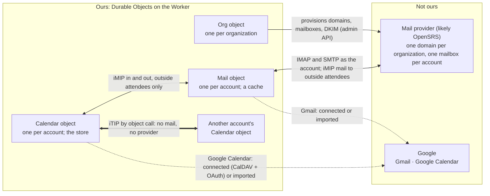

# FreeFlow platform: identity, accounts, objects, and the apps on top

Status: design proposal · 2026-11-06, revised 2026-11-09 (personal and shared agents: §2.3, §5.5) and 2026-11-10 (every agent is a principal with an
account in one organization; shared agents are for the whole organization; group agents later). Nothing in the repository changes by this document. The rulings in §10 go to
`decision_log.md` when Scott confirms them. The diagrams are `platform-layers.html` beside this file (open it in
a browser: the layer stack, one request end to end, and the platform's edges); the Mermaid figures in §0 are the
same pictures.

This document gathers three rounds of design discussion into one proposal: the platform the suite already is but has
not written down (§5, §6), organizations and sharing (§4), and a new identity model built for hosted email (§2, §3).
Where it contradicts `freeflow-suite.md`, `mail-api.md`, `calendar.md` or `cloudflare-migration.md`, this document
is the newer intent and §8 lists each reversal.

## 0. The picture

Read it from the bottom. Each layer serves the one above it and knows nothing about it.


The platform's edges, after the rulings of §3.5: mail is outsourced, calendars are ours.



## 1. What this replaces

- **One identity concept today.** The directory's `users` row is the login, the member, the mailbox owner and the
  calendar owner at once. Mail and Calendar objects are keyed by user id. With hosted email a person in two
  organizations has two addresses, two inboxes and two sets of calendars, so the person and the member split (§2, §3).
- **No hosted mail or calendars.** `mail-api.md` and `calendar.md` both say people connect accounts they already
  have. This proposal reverses that: the organization hosts both through an outside provider, and the external
  account becomes the secondary case.
- **Two sharing scopes.** Docs has private or organization-wide and nothing between. Chat shares by channel. Mail and
  Calendar share nothing. §4 gives every app one grant model.
- **Groups are dropped for now.** The earlier sharing round proposed groups inside an organization. The ruling is no
  groups in the first version; a channel's membership is the only "set of people" a grant can name.
- **The assistant is not an agent today.** The in-app assistant is a Docs feature with its own tools; agents that
  join through the bridge are members; clients on `/mcp` act as a person. §2.3 makes all three one thing: an agent,
  personal or shared, that runs on the platform or outside it.
- **The app recipe becomes a contract.** Calendar's spec says "built the way Mail was built" and lists about eight
  places to edit by hand. §6 makes that one manifest.

## 2. Layer 1: identity

Everything that must be found before an organization is known. It lives in the Directory object and stays small.

### 2.1 Principals

A principal is a person or an agent. It is how someone signs in and nothing more: no address, no inbox, no role.

| Column | Meaning |
| --- | --- |
| `id` | the principal's id, used everywhere below |
| `kind` | `person` or `agent` |
| `login_email` | a person's sign-in email, unique; may be a personal Gmail; **never an address anyone writes to** |
| `display_name` | the default name, which each account may override |
| `sponsor_id` | required for an agent: the person principal responsible for it; null for a person |
| `organization_id` | required for an agent: the one organization it belongs to (§2.3); null for a person |
| `mode` | for an agent: `personal` or `shared`, later `group` (§2.3); set at creation and never changed; null for a person |
| `status` | `active`, `suspended`, `deleted` |

An agent's `login_email` is a synthetic unique value; agents never sign in by email.

### 2.2 Credentials

| Table | Who | What |
| --- | --- | --- |
| `passwords` | person | argon2id hash, one per principal |
| `oauth_identities` | person | provider + subject → principal (Google today; Apple on iOS) |
| `agent_tokens` | agent | hashed bearer tokens, revocable, the bridge's credential |
| `sessions` | person | token hash → principal, expiry, client |

Rules: a person signs in by password or SSO, and may have both. An agent signs in only by token. The sponsor must be
a person. An agent cannot sponsor an agent, own an organization, or hold the admin role.

### 2.3 Agents: personal and shared

An agent cannot judge, as a person can, what is fine to tell whom. An HR person knows the CEO may ask about salaries
and others may not; an agent holding the HR person's access would answer anyone who asks. So the platform never asks
an agent to make that judgement. Every agent is one of two kinds, and the kind decides its access by a rule the
platform enforces, not by the model's behaviour.

| | Personal agent | Shared agent |
| --- | --- | --- |
| Access | its sponsor's in the same organization, limited by scopes | only its own grants; **never inherits from its sponsor** |
| Who may start a turn | the sponsor only | every member of its organization |
| Its account | `personal_agent`: no address, mailbox, calendars or channels; it acts **as** the sponsor, marked `via` | `native`: its own address, mailbox, calendars (§3.3) |
| Channels, mentions, DMs from others | no | yes, like any member |
| Things shared with it | not possible; it already sees what the sponsor sees | by grants, like any member |
| The sponsor's part | owner and source of access | answers for it; gives it no access |
| What an admin may do | see it, suspend it, remove it; never use it (§3.3) | everything they may do with a member |
| Examples | the in-app assistant (§5.5); Claude Desktop on `/mcp` | Builder; an HR bot; Omni, the team's helper |

**Every agent is a principal in one organization.** An agent has a principal row like any other and exactly one
account, in the organization it was made in (`organization_id` on the principal). A person with accounts in Acme and
Initech has two personal agents, one in each, with separate memory: nothing an agent learns in one organization
reaches another, and when a person leaves an organization their agent there goes with the account. To work in two
organizations, a person connects two agents.

**The rule: an agent holds a delegation or holds grants, never both.** A personal agent holds only a delegation; a
shared agent holds only grants. `mode` is a column on the principal, so a constraint enforces it.

**A personal agent is a delegation with a runtime.** The delegation is the MCP OAuth grant already in the directory
(`oauth_tokens` and its neighbours), carrying the sponsor's `account_id` in the agent's organization, the scopes and
the agent's principal id. The agent's own account exists so the organization can see, suspend and remove it, and so
its runtime, subscriptions and events have an owner; it holds no grants and nothing can be shared with it. Its caller
context is the sponsor's account with `via: <agent id>` (§3.6); grants are checked against the sponsor. It may act in
shared places for the sponsor ("post this summary to #sales" posts as Ann, via her agent), since nobody else can
start its turns; any write someone other than the sponsor can see (posting, sending, sharing, deleting, editing a
shared object, answering an invitation) shows the sponsor a confirm card first. Its conversation and memory are
private to the sponsor, as a mailbox is: an admin sees the agent but cannot start its turns, read its conversation or
memory, or change its scopes.

**A shared agent is a member of the whole organization.** It sees only what is shared with its account. Every member
of its organization may start its turns, in the panel, by mention, by DM or by a subscription. Each turn carries
`invokedBy: <account>` so it knows who asked, and its writes are its own ("Omni, asked by Scott"). **A shared agent
keeps no secrets from the organization:** anything shared with it or told to it may reach any member. The platform
cannot enforce how an agent outside it keeps memory, so the rule is stated to people instead: the Share dialog (§4.3),
a DM with a shared agent ("Not private: anyone in Acme can ask Omni") and the panel say so.

**Group agents, later.** A `group` agent is a shared agent whose users are an explicit set of accounts in its
organization instead of all of them. The set is the agent's **"who may use it" list**; its sponsor and the
organization's admins edit it, and adding someone is a sharing act: they can then ask about everything already shared
with the agent, so the change shows what the agent can see and tells the people who shared it. Until group agents
exist, an agent whose knowledge only some members should reach is not built as a shared agent.

**Where an agent runs is a separate choice from its kind** (§5.5): outside on `/mcp` only, outside on the bridge, or
hosted by the platform. Any kind runs in any of the three.

**Connecting an agent.** The OAuth consent page and the bridge's self-registration ask one question beside the
organization:

> Connect this agent as: **my personal agent** (it acts as you and sees what you see; only you can use it) · **a
> shared agent** (a member with its own address; it sees only what is shared with it; everyone in Acme can use it)
> · or reconnect an existing agent: *Scott's assistant · Omni*

Personal creates an agent principal with `mode: personal` in the chosen organization, its `personal_agent` account,
and a delegation with the scopes the person picks. Shared creates an agent principal with `mode: shared`, a `native`
account with the address the person picks, and an agent token. The organization's policies on sponsoring agents
apply (§3.1). Reconnecting names an existing agent in the chosen organization, so a new machine does not make a
duplicate. The kind and the organization never change; to switch, make a new agent, so an agent never quietly gains
or loses access. One client may hold several, a token for each.

## 3. Layer 2: organizations and accounts

### 3.1 Organizations

Any signed-in person may create an organization and becomes its **owner**. Roles are `owner`, `admin`, `member`.
The owner may transfer ownership and promote admins. Admins invite, remove, suspend, manage domains and policies.

Policies, all in one JSON column, and few: who may invite (admins or every member); whether SSO on a verified domain
joins automatically (today's `organization_domains` rule); whether members may connect personal agents beyond the
in-app assistant (§5.5), and whether they may make shared agents, as two policies; whether link sharing
is allowed; whether shared agents' addresses go on an agent subdomain (§3.2).

The directory holds the organization row, its slugs and domains. The Org object holds everything else about it.

### 3.2 Domains and addresses

- An organization registers one or more domains and verifies each with a DNS record. One is primary. An
  organization with no domain of its own gets `<slug>.freeflow.im`.
- A domain belongs to one organization. An address is therefore unique across the platform.
- The directory keeps `addresses (address → account_id)`. Inbound mail routing, invitation delivery and the
  address completer resolve through it.
- A login email and an address may be the same string, as when the organization runs Google Workspace on its domain
  and the person signs in with Google. They stay two columns: one is a credential, the other a name.
- **Addresses are plain ASCII, for people and agents alike.** No emoji or other marker in the local part: addresses
  with non-ASCII characters before the `@` need SMTPUTF8 (RFC 6531), which many servers, spam filters and forms still
  reject, and which people cannot easily type. A shared agent's address is an ordinary one (`omni@example.com`). A
  personal agent's account has no address (§2.3): it acts as its sponsor, and anyone who wants it to do something
  writes to the sponsor.
- **Agents are marked where an address is shown, not in the address.** The directory knows each address's kind, so
  every surface that shows one (the completer, the Share dialog, the member list, attendee lists, Chat) shows a
  shared agent as **Omni 🤖** with "agent, sponsored by Tom", and a personal agent's acts as **Tom (via
  assistant)**. Mail from a shared agent to the outside world carries the mark in the display name, which is safe
  everywhere (RFC 2047): `"Omni 🤖" <omni@example.com>`. Mail a personal agent sends from its sponsor's mailbox
  carries an `X-Flow-Via: agent` header and a closing line, "Sent by Tom's assistant".
- **An agent subdomain, if the organization wants one.** A policy (§3.1) can put shared agents' addresses on a
  subdomain of the primary domain, `omni@agents.example.com`: still ASCII, visible to people and to their mail
  filters, and with its own sending reputation and daily send limit. It costs one more domain at the provider and
  in DNS. Off by default.

### 3.3 Accounts

The new thing. One per principal per organization; today's `memberships` row with an id, an address and a state.

| Column | Meaning |
| --- | --- |
| `id` | the account id; **Mail and Calendar objects are keyed by it** |
| `principal_id` | who holds it |
| `organization_id` | where |
| `address` | `local@domain`, the account's name inside the organization, unique; none for a guest |
| `display_name` | what members see; defaults from the principal |
| `role` | `owner`, `admin`, `member` |
| `kind` | `native` (an address, a mailbox, a native calendar), `guest` (none of them) or `personal_agent` (none of them, no channels, no grants; §2.3) |
| `state` | the provisioning state (§3.4), then `active`, `suspended`, `removed` |

Everything the organization gives a member hangs off the account: the mailbox, the calendars, the role, the profile.
When a person leaves, the organization keeps the account's mailbox and calendars under its own policy and the person
keeps their login. That split is the reason for the layer.

**Agent accounts** follow four rules. (1) An agent has exactly one account, in its own organization, where its
sponsor must hold one. (2) When the sponsor's account is suspended or removed, the agent's account follows. (3) A
shared agent's account is otherwise a full account: `builder@acme.com`, a mailbox, calendars. Inviting it to a
meeting is an ordinary attendee line; mailing it is ordinary mail. Every surface that shows the agent shows the 🤖
mark and "sponsored by" (§3.2); the address itself is plain. (4) A personal agent's account has kind
`personal_agent`: no address, no mailbox, no calendars, no channels, no grants.

**Admins see every principal.** The member list shows people, guests, shared agents and personal agents, each with
its kind and sponsor ("Tom's assistant · personal agent of Tom"). An admin may suspend or remove any agent, as they
may a person. A personal agent is private as a mailbox is: the admin view shows that it exists, its scopes, where it
runs and when it last ran, and nothing else; no admin tool starts its turns or reads its conversation or memory.

**Guests** are members with no address, no mailbox and no native calendar: the same roles, channels, DMs, mentions and
Docs. A guest has no address at all, because an address with no mailbox behind it bounces. An owner or admin picks each
account's kind (`PATCH /v1/workspaces/:id/accounts/:accountId/kind`, or every `member` at once with
`POST /v1/workspaces/:id/accounts/kind`); the owner is always native, and so is an agent, which is brought in to work
and needs its address and mailbox for it. A new joiner is native unless the invitation that brought them in was a guest
invitation (`POST /v1/workspaces/:id/invites { kind: 'guest' }`, docs/specs/workspace-admin.md §6.5); there is no
default-kind policy (operator ruling, decision_log 2026-11-09). A guest is never provisioned and starts `active`.
Made a guest, an account's address is let go and a hosted mailbox is suspended, kept for the retention period and then
deleted by the daily sweep; its address goes to nobody else meanwhile, and comes back (the mailbox resumed) if the
account is made native again in time. Made native otherwise, it gets a new address and is provisioned.

### 3.4 Provisioning

An account's state machine, run from the Org object on an alarm with retries:

`requested → mailbox_ready → calendars_ready → active` · `suspended` · `removed`

Chat and Docs work from `requested`; Mail and Calendar show "being set up" until `active`. The mailbox credential is
created by the platform at `mailbox_ready` and sealed with the data key in the account's Mail object, the same sealing
the object does today for user-entered passwords. On `removed`, the mailbox is suspended at the provider and kept for
the organization's retention period, then deleted.

### 3.5 Mail is outsourced; calendars are ours

The platform does not run a mail server. Mailboxes come from a hosted provider through its admin API. Calendars are
the platform's own: the Calendar object is the store, not a cache of someone else's server, and scheduling between
accounts is a call between two of our objects.

#### Mail: a hosted provider, likely OpenSRS

Three requirements on the provider (the calendar requirement of the earlier draft is gone, since calendars are ours):

1. An admin API to create, suspend and delete mailboxes and set their credentials.
2. IMAP (or JMAP) and SMTP submission per mailbox, so the Mail object's existing drivers apply.
3. Custom domains with DKIM through the API, and the MX, SPF and DMARC records to show the organization's admin.

**OpenSRS Hosted Email** (Tucows) meets all three, checked 2026-11-06 from its documentation: the OpenSRS Mail API
(JSON over HTTPS at `admin.a.hostedemail.com/api`, a company or domain administrator's credentials) with
`change_domain` and `change_user` (`create_only` to create; `type: mailbox`, `password`, `quota`, `aliases`; service
switches `service_imap4`, `service_smtprelay`, `service_webmail` set to enabled, disabled or suspended), `get_user`
and `delete_user`; IMAP and SMTP per mailbox; DKIM by `change_domain` with `dkim_selector` and `dkim_key` (the
platform generates the key pair and keeps the private key, since OpenSRS cannot return it; 1024-bit on OpenSRS's own
nameservers). Limits to carry into the account model: 2,000 aliases per mailbox, at most 10,000 sends a day per
domain, no catch-all on new domains. Each organization is a domain under one FreeFlow company at OpenSRS;
`<slug>.freeflow.im` subdomains are domains there too. The organization's provider ids and the admin credential live
in the organization's row, sealed.

The platform sets every mailbox password itself at `mailbox_ready` and seals it in the account's Mail object. People
never see it; they use FreeFlow Mail. The provider's webmail is switched off per domain.

#### Calendars: native calendars inside the existing Calendar object

Calendar shipped on 2026-11-04 to 06 (PRs #704 to #712, `packages/calendar`, `packages/edge/src/calendar/`): one
object per person holding **connected** calendars (CalDAV with iCloud and Fastmail presets, Google with OAuth), a
complete copy kept fresh by an alarm, the client with FullCalendar, invitations across Mail and Calendar with iMIP
(`imip.ts`, `invites.ts`), the eight tools on `/mcp` and in the assistant. All of that stays. What this proposal adds
is a **native** calendar kind beside the connected ones: calendars whose store is the object itself, scheduled
between accounts by object calls. Connected calendars remain the secondary path, as external mailboxes are for Mail.

- **The object is the store for native calendars.** A native calendar has no sync alarm and no etag against another
  server; a write is a transaction in the object and an event on the bus. The CalDAV and Google drivers keep serving
  the connected calendars as built.
- **Scheduling between accounts is ours.** An attendee's address resolves through the directory's `addresses` table
  to an account; the organizer's Calendar object delivers the iTIP REQUEST to that account's Calendar object by
  binding (`CALENDAR.get(idFromName(accountId))`), which puts the event on the attendee's default calendar with
  `needs-action` and publishes `calendar.invited`. REPLY, CANCEL and updates travel the same way. Only the organizer's
  object may change an event; an attendee's object may only set its own status. This is RFC 6638's behaviour with the
  transport replaced by an object call, and it is what makes an agent invitation identical to a person's.
- **External attendees get iMIP by mail.** The organizer's Calendar object asks the account's Mail object to send the
  invitation (`text/calendar; method=REQUEST`) from the account's mailbox over SMTP. Inbound: the Mail object
  recognises a `text/calendar` part in the account's inbox and hands it to the Calendar object
  (`POST /v1/calendar/invites`, as `calendar.md` §4 already defines), which applies it if the sender is the
  organizer on record. Replies from external attendees come back the same way.
- **Free/busy needs no provider.** `find_free_time` reads the attendees' Calendar objects directly, subject to grants
  (§4): an attendee's busy intervals are visible to any member of the same organization; details only with a grant.
- **CalDAV for outside clients is optional and later.** Apple Calendar or Thunderbird would need a CalDAV server on
  the Worker over the object: PROPFIND, REPORT (`calendar-query`, `calendar-multiget`, `sync-collection`), PUT with
  If-Match, DELETE. `calendar.md` §2.3 already judged that subset small enough to write. It is not in the first
  version; the suite's own client and the tools are.
- **Libraries, not a server.** `ical.js` for parsing, serialising, time zones and recurrence expansion (already
  chosen). The iTIP state machine (which method may change what, sequence and DTSTAMP rules) is a few hundred lines
  written here, with tests from RFC 5546's examples. No calendar server, no Stalwart, no SOGo.

#### Google data: connected or imported

Gmail and Google Calendar stay supported as a secondary path, two ways:

- **Connected, kept in sync.** Gmail is a second account under the person's Mail object, as connected accounts work
  today (IMAP and SMTP with an app password, or XOAUTH2 with a Google refresh token). A Google calendar is a calendar
  row with `source: google` in the Calendar object, filled by the CalDAV driver with an OAuth credential (or Google's
  REST API), refreshed by the alarm, shown overlaid beside the account's own calendars; writes pass through to Google,
  and scheduling on it is Google's. Shareable inside the organization as viewer only.
- **Imported once.** Messages copied from Gmail into the hosted mailbox over IMAP, or events copied from a Google
  calendar into one of ours; after that the data is the platform's and Google is not involved. The migration path.

Both need a Google refresh token, which the suite does not hold yet: an auth-code flow on the Worker,
`GOOGLE_CLIENT_SECRET` used at last, the token sealed in the account's object. The calendar scope is "sensitive" at
Google, so until the OAuth app is verified only listed test users can connect (`calendar.md` §2.2).

Consequences: `calendar.md` §1's non-goals "no hosted calendars" and "no shared organization calendars" are reversed;
§2.1 (one object per person) becomes one per account; the drivers, cache and sync of §2.2 to §2.4 stay for connected
calendars; the invite card in Mail (§6) stays as built. `mail-api.md`'s "no hosted mailboxes" is reversed by the
provider path above.

### 3.6 The caller context

On every request the Worker resolves, once: the principal (from the session, agent token or MCP grant), the account in
the organization the request names (`?workspace=` today), its role and state, and the ids of the channels it belongs
to. It passes that **caller context** to the app object. App objects never call the directory to authorize.

Two fields record agents (§2.3). `via: <agent id>` means a personal agent is acting as this account; grants are
checked against the account as usual. `invokedBy: <account id>` means a shared agent, whose own account this is, is
running a turn someone asked for. Both go into the event envelope (§5.2), so history reads "Ann (via assistant)" or
"Omni, asked by Scott".

A per-person object becomes a **per-account object**: `idFromName(accountId)`. Switching organizations in the bar
switches the inbox and the calendars. An external mailbox a person connects by hand attaches to the account of the
organization they connected it in.

## 4. Layer 3: objects, containers and grants

### 4.1 References

Every object an app owns is named by a reference: `organization / app / kind / id`. A reference is what a grant
names, what the share index stores, what a chip or an unfurl renders, and what an intent (§5.3) carries.

### 4.2 Containers

Objects sit in containers: a file in a folder, an event in a calendar, an artifact or message in a channel. Access
inherits down the container chain unless an object has grants of its own. This keeps grant lists short and matches
what people expect from Drive. Each app declares its container kinds in its manifest.

### 4.3 Grants

A grant is one row in the owning app's object:

`grants (object_kind, object_id, principal, role, granted_by, granted_at, expires_at)`

Principals a grant may name, all within one organization:

| Principal | Meaning |
| --- | --- |
| `account:<id>` | one member, person or shared agent; never a personal agent's account, which holds no grants |
| `channel:<id>` | the channel's members, as a set; the channel gets a card saying what was shared |
| `org` | every member of the organization |
| `link:<token>` | anyone with the link, with an optional expiry; replaces Docs' public links |

Groups are not in the first version. The principal column is a string so they can be added without a migration.

Roles are the same everywhere; each app maps them to its own actions:

| Role | Can |
| --- | --- |
| `viewer` | read |
| `editor` | read and change |
| `manager` | editor, plus change sharing |
| `owner` | manager, plus delete and transfer; the creator by default, as a column, not a grant |

A private object has no grants. Today's "Organization files" is one grant, `org` as editor, on the root folder, so the
migration from Docs' `private` flag is mechanical.

Sharing with a shared agent shares with the whole organization, so the Share dialog says so: "Everyone in Acme (66
people) will be able to ask Omni about this." The person makes the judgement once, when they grant; the agent never
has to. With group agents (§2.3) the dialog names the agent's list instead, and later offers **Add an assistant**: a
new group agent with the person as sponsor, a grant on this object only, and "people with access to this object" as
its list.

An object may carry a **thread**: one conversation attached to it that everyone with access sees. It is where
several people talk to the same shared agent about the object (§5.5).

### 4.4 Where grants are evaluated

In the app object, with one shared library (`@flow/shared` grants: the table, the resolve function, the role names).
The effective role is the highest of: the owner column, the object's own grants, the container chain's grants, each
matched against the caller context's account id, channel ids and the organization. No call leaves the object.

Per-account objects accept callers other than their owner. Ann's calendar lives in Ann's Calendar object; when she
shares it with `#sales`, a reader's request goes to Ann's object with the reader's caller context, and Ann's object
checks the grant. Mail is not shareable; sharing a message is copying it into Chat or Docs, which exists.

### 4.5 The share index

Every grant change is reported to the Org object through the outbox pattern the Org object already uses to report
agent tokens to the directory. The Org object keeps `shares (reference, principal, role, granted_by, at)` and answers
"shared with me", feeds search, and resolves references into chips. Without it, "shared with me" would be a fan-out
over every app object.

### 4.6 Events

`sharing.granted` and `sharing.revoked` are the first app-wide events (§5.2). They feed the share index, the
notification row ("Ann shared Q4 plan with you"), the channel card, and open clients.

## 5. Layer 4: kernel services

Five services every app uses and none owns.

### 5.1 Caller context

§3.6. Resolved by the Worker, passed to the object, the only input to authorization.

### 5.2 The event bus

**Today.** An event is `{type, workspaceId, channelId?, ts, data}` with about 28 Chat-only types in `shared/events.ts`.
A service calls `publishEvent(subject, event)` inside a request and the Org object's `broadcast` sends the frame to
its hibernating sockets with one rule: a user subject to that user, a private channel's event to its members, the
rest to every socket in the organization. Nothing is stored, nothing is acknowledged, and a socket that is down
misses the event. The bridge drops most events and runs a turn only for a DM, an @-mention, a reply in a thread it
is in, a message in a channel it created, or anything under `eventScope: all`; those rules are code in the bridge.
Mail and Calendar emit nothing and poll. The only timed trigger is a scheduled message that mentions an agent.

**The bus is a logical event stream, separate from the sockets.** The socket stays the transport for the live UI;
the bus is where events are kept and read.

- **One event log per organization, in its own Durable Object** (`Events`, `idFromName(organizationId)`). Every
  app object publishes into it by binding, the Org object included, so publishing is one code path for every app,
  consumers waiting on the log do not contend with chat, and the log has its own size budget. The log is append-only:
  `events (seq, id, type, actor, ref, channel_id, caused_by, depth, ts, data)` with `seq` monotonic within the
  organization. Retention is a window (30 days, or a row cap). Events are immutable; a correction is a new event.
  Presence and typing are not events: they stay on the sockets and are never replayed.
- **The envelope** is `{id, seq, type: '<app>.<type>', organizationId, actor: accountId | null, ref?: reference,
  channelId?, causedBy?: jobId, depth, via?: agentId, invokedBy?: accountId, ts, data}`. Each app declares its types
  in its manifest. Per-account objects (Mail, Calendar, the agent runtime) publish into their account's organization.
  `via` and `invokedBy` come from the caller context (§3.6); a subscription's "ignore what my consumer caused" rule
  matches a personal agent by `via` and a shared one by `actor`.
- **Subscriptions are durable consumers with a cursor.** `subscriptions (id, name, consumer: accountId, owner:
  accountId, filter, delivery, cursor, created_by, created_at, parked_at)` in the Events object. The queue is not a
  copy of events: it is every event after the cursor that matches the filter and that the consumer may see, read
  from the log at request time. Visibility is evaluated at read time from the share index (§4.5) and channel
  membership, so a revoked grant stops delivery on the next read. Acknowledging advances the cursor, cumulatively
  and in order. A consumer away longer than retention gets `gap: {from, to}` and its cursor moves to the window's
  start. `filter` names any of: type patterns (`calendar.*`, `chat.message.created`), a reference or container, a
  channel, an actor kind (person, agent, any), a text match, and `self: true` for events about the consumer's own
  objects. "Every item added to my calendar" is `{types: ['calendar.event.added'], self: true}`.
- **Reading is HTTP and works at any time**, with the same four operations as tools in the registry (§5.4), so the
  bridge, `/mcp` and the hosted agent runtime read a queue the same way:

  ```
  POST /v1/events/subscriptions              { name, filter, delivery? }     → { id, cursor }
  GET  /v1/events/subscriptions/:id?limit=100&wait=30                        → { events, next, gap? }
  POST /v1/events/subscriptions/:id/ack      { cursor }                      → { ok }
  GET  /v1/events?since=<seq>&types=&ref=                                    → one-shot read, no subscription
  ```

  `wait` long-polls: the object holds the request until an event matches or the time runs out, so a connected
  consumer gets events at once without a socket. A read never acks; a crash between read and ack redelivers.
- **Delivery modes** are options on a subscription, not different systems:

  | Mode | On a match |
  | --- | --- |
  | `pull` | nothing; the consumer reads when it likes |
  | `socket` | the consumer's open socket gets a poke naming the subscription; it reads and acks over HTTP |
  | `webhook` | the object POSTs the event to a URL with an HMAC signature, retries with backoff, parks the subscription after repeated failure and notifies the owner |
  | `wake` | a job row is created for the agent (`agent_jobs (id, subscription_id, agent, event_id, prompt, state, attempts, lease_until)`), delivered as an `agent.job` event on the agent's own subscription; whoever runs the agent (the bridge, or the platform's runtime for a hosted agent, §5.5) acks it, runs the turn where the subscription says, and reports done or failed; a lapsed lease retries, three failures park it |

  A personal agent's subscriptions are its own account's, but what it may see is checked against its sponsor's
  account, and its jobs carry `via`. Their output goes only to places only the sponsor sees (the sponsor's
  conversation with the agent, a notification), unless the sponsor confirms. A shared agent's subscriptions are its
  own account's; a turn they start has no `invokedBy` unless a person's act caused the event.

  A trigger is a subscription with an action. People create them in an **Automations** page and from any object's
  menu ("When this changes…"); agents create them with a tool under a scope; the bridge creates its mention, DM and
  thread subscriptions at join, so today's behaviour is expressed on the one path. Schedules are subscriptions on
  `schedule.tick`, which the Events object's alarm publishes for each due schedule; a scheduled message is one with
  a post action. The bridge's `start_task` becomes a job one agent files for another.
- **The UI socket is a consumer too.** A client's `auth` frame carries `since: seq`; the Org object answers with the
  backlog the client may see, read from the Events object, then live events as now. After a reconnect nothing is
  lost and nothing is refetched.
- **Loop safety on the server.** An event caused by a job carries `causedBy` and `depth + 1`. A subscription ignores
  events its own consumer caused unless it opts in, and the organization has a depth cap (default 4) past which no
  wake fires and the owner is told. This replaces the bridge's `agentChainLimit`.
- **Guarantees.** At least once. In order within one organization. An agent in three organizations has three
  subscriptions. Reads are bounded (`limit` ≤ 500) and cheap: one indexed range scan on `(seq)` with the filter in
  SQL and visibility applied per row.

The mechanism is Figure 4 of `platform-layers.html`: publishers on the left, the log and its subscriptions in the
Events object, consumers on the right reading by cursor.

**Why not Cloudflare Queues for the bus.** Queues is a work queue: a message is consumed once by competing consumers,
is gone once acknowledged, is not delivered in order, and retention is at most 14 days. The bus needs many readers of
the same event each with their own cursor, history a new subscription can start from, order within an organization,
and visibility checked at read time. A log in SQLite with a cursor per subscription gives all four. Queues does fit
the deliveries that are "keep trying until done": webhook posts, agent wake jobs, APNs pushes and the provisioning
steps against the mail provider, each today a table drained by an object's alarm. Those move to a Queue with a
dead-letter queue when they are built; the log stays the source of truth and the Queue is the retrying courier.

The first events beyond Chat: `sharing.granted`, `sharing.revoked`, `calendar.event.added`, `calendar.event.updated`,
`calendar.event.cancelled`, `calendar.invited`, `mail.received` (from the Mail object's alarm, for the account's own
inbox), `docs.changed`, `schedule.tick`, `agent.job`. A subscription on Ann's mail that wakes Builder gives Builder the
reference, not the message; reading the body needs a grant or a delegation like anything else.

### 5.3 References and intents

A reference (§4.1) renders the same everywhere: the app's manifest gives a resolver (name, icon, url, a one-line
summary) and the shell draws the chip or the unfurl. An intent is a small verb an app can ask of another: `open`,
`create`, `share`. "Create event from this thread" in Mail is an intent to Calendar with a reference, not a hand-built
URL. The current pairwise wiring (`/calendar?new=`, `/?open=`, the Calendar ↔ Mail object bindings) becomes this.

### 5.4 Tool registry

Each app registers its tools and scopes once (as `mailTools.ts` and the planned `CALENDAR_TOOLS` already do). The
registry serves one list, filtered by the agent's kind (§2.3), not by how it connected: a personal agent gets what
the delegation's scopes allow; a shared agent gets what its account can see. `/mcp`, the bridge's MCP and the hosted
runtime (§5.5) all read the same list. The OAuth consent page's scope groups come from the registry, not a
hand-edited list.

Tools are of two kinds, and the registry marks each. **Server tools** run in the app's object. **Browser tools** run
in the open editor against what is on screen (insert into this document, open this message) so the change is
undoable. Browser tools carry an agent's edits; they give no access. They are offered only in a turn started from a
page a person has open (§5.5), and each call is checked against the agent's own access: the sponsor's for a personal
agent, its own grants for a shared one. Today the three doors keep their lists by hand: `/mcp` serves the Docs
plugin's tools and the Mail tools, the assistant has its own server and browser tools with a few Mail tools imported,
and the bridge's MCP has Chat's.

### 5.5 Agents at work: runtimes, the panel, browser tools

**Three runtimes, one agent model.** Where an agent's loop runs is separate from its kind:

| | Personal | Shared |
| --- | --- | --- |
| `/mcp` only (the client calls when it wants) | Claude Desktop acting as Scott; exists today | an agent that reads and acts when its client calls; no wake-ups |
| Bridge (events, `wake` jobs) | Scott's own Claude Code, woken by Scott's subscriptions | Builder, Omni; exists today |
| Hosted (the platform runs it) | **the in-app assistant**, by default for every person | a shared agent the platform runs for the organization |

A hosted agent has an `AgentRuntime` object, one per agent and so one per organization: it holds the model's
working state (paused turns, tool results), takes `wake` jobs from `agent_jobs` as the bridge does, and calls the
model with the platform's key (limited per organization) or the sponsor's own key. Subscriptions, jobs, leases,
`causedBy` and the depth cap are the same whoever runs the loop. The desktop app's "use my own Claude Code" becomes a
personal agent on the bridge.

**The in-app assistant is the person's hosted personal agent.** Every person gets one in each organization, when
their account there becomes `active`, named "<name>'s assistant", with the person as sponsor. Its conversation with
the person is one private conversation, shown in the panel of every app and in that organization's Chat. Within an
organization it is the same agent, with the same memory, whether the person reaches it from the panel, from Chat or
through a subscription; switching organizations in the bar switches to that organization's assistant. The settings
for a person's own model key move to it.

**The panel can talk to any agent the person may use.** It picks the person's assistant by default; the person may
pick a shared agent of the same organization instead (Omni). The panel shows a shared agent's audience under its name
("Omni · everyone in Acme").

**A turn started from an open page** differs from other turns in three ways:

1. **It streams.** The panel calls the runtime directly and streams the answer; a `wake` job is too slow for this.
2. **It gets page context**, as the app's manifest describes it: a reference to the open object and the selection.
   For a shared agent, only objects it has a grant on are sent: the open document, not the file list in the sidebar
   or other tabs. On a page it cannot see, the panel says "Omni can't see this page" and offers **Share with Omni**,
   or the person's own assistant.
3. **It gets browser tools.** When the model calls one, the turn pauses, the call goes to the tab that started the
   turn, the tab runs it in the editor and posts the result, and the turn resumes (the assistant works this way
   today). Each call is checked as §5.4 says: a reading tool needs `viewer` on its object, a changing tool `editor`;
   a tool that opens another object needs a grant on that one. If the tab closes, the calls fail with "page closed"
   and the turn continues with server tools or stops. Browser-tool changes can be undone in the editor; server-tool
   changes cannot, and the panel marks which is which.

Example: Scott and Ann are in an organization. Scott makes Omni, a shared agent, and shares a document he and Ann
are writing with Omni as `editor`. Scott opens the document, picks Omni in the panel and asks for an edit. Omni has
`editor` on the document, so the turn gets the page context and the Docs browser tools; the edit goes through Scott's
editor, he sees it at once and may undo it, and history shows "Omni, asked by Scott". Omni uses none of Scott's
access.

**Several people, one agent, one object.** For Ann and Scott to work with Omni together, the document's thread
(§4.3) holds one conversation with Omni that both see; a mention of Omni in a comment wakes it through a subscription
on `docs.changed` for the file. Omni can edit as itself through server tools; edits as **suggestions** that a person
accepts are the safer form. Both need Docs to gain live co-editing and suggestions (§9): today Docs saves whole
files, so two editors at once overwrite each other.

**External agents** get no browser tools in the first version, of either kind. An external personal agent holds the
sponsor's data where it runs, the sponsor's choice, as with Claude Desktop today; an external shared agent holds only
what was shared with it.

### 5.6 The shell

The suite bar's tabs, the Worker's page routes, the asset assembler and the OAuth scope groups all read the list of
manifests instead of four hand-edited files.

## 6. Layer 5: apps

### 6.1 The manifest

One declaration per app:

| Field | Example |
| --- | --- |
| `name`, `path` | `calendar`, `/calendar` |
| `scope` | `organization` (one object per organization) or `account` (one per account) |
| `object` | the Durable Object class and its migration tag |
| `routes` | the Hono module under `/v1/<name>` |
| `kinds` | object and container kinds it owns, with a reference resolver for each |
| `tools` | tool definitions and the scopes that gate them |
| `assistant` | the page context it provides and the browser tools it runs, for any agent's turn started from its page (§5.5) |
| `tab` | the suite-bar entry: label, shortcut, badge source |
| `client` | the Vite build folder and base path |
| `events` | the event types it publishes into the organization's log |

The manifest is also the spec a factory agent follows to add an app.

### 6.2 The apps as they map

| App | Scope | Containers → objects | Shareable | Change from today |
| --- | --- | --- | --- | --- |
| Chat | organization | channel → message, artifact, file | by channel membership (unchanged) | channels become grant principals |
| Docs | organization | folder → file, sheet, deck, doc | yes, grants | `private` flag → grants; Share dialog; "Shared with me" |
| Mail | account | mailbox (hosted) → folder → message | no | keyed by account; provisioned, not connected |
| Calendar | account | calendar → event | yes, calendars | keyed by account; native calendars stored and scheduled here beside the connected ones; shared calendars (reverses a v1 non-goal) |
| Mini apps | organization | artifact (link) | by channel (unchanged) | later: tools, events, a scoped token |

### 6.3 Clients

The platform is web first. The native apps know Chat only; each new tab is a web view or a Parity entry. The agent
bridge is an app too: it holds a shared agent's token or a personal agent's delegation, learns the agent's account
and organization (and, for a personal agent, its sponsor's account there), subscribes to events by namespace and uses
the registry's tools. A bridge that works in two organizations runs two agents. Its self-registration asks the
same "personal or shared" question as the consent page (§2.3).

## 7. One request, end to end

Ann invites her team's agent to Thursday's review.

1. **Apps.** Ann, in Calendar, adds `builder@acme.com` as an attendee and saves.
2. **Kernel.** The Worker resolves her session: principal Ann → account `ann@acme.com` in Acme, role member, her
   channel ids. The caller context goes to her Calendar object.
3. **Objects.** Her Calendar object checks she is the calendar's owner and stores the event in its own SQLite, in
   one transaction with the scheduling it starts next.
4. **Objects.** Her Calendar object resolves `builder@acme.com` through the directory to Builder's account and
   delivers the invitation to Builder's Calendar object by binding. No mail is sent: both calendars are the
   platform's own. An attendee outside the platform would get iMIP mail from Ann's mailbox instead.
5. **Kernel.** Builder's Calendar object stores the event with `needs-action` and publishes `calendar.invited` into
   Acme's Org object.
6. **Kernel.** The Org object fans the event out to Builder's bridge socket.
7. **Identity.** The bridge wakes the agent. With its own agent token the agent calls `get_event` and
   `respond_to_event`. Ann's view shows "accepted".

Nothing in the path is agent-specific. Replace Builder with a person and only step 6 changes: a notification instead
of a bridge socket.

## 8. What changes, per package

- `packages/edge/src/directory`: `users` → `principals` + `credentials`; `memberships` → `accounts` with address and
  state; `addresses`; `organizations` gains owner and policies; MCP grants carry `account_id` and the agent's principal id; principals gain
  `organization_id` and `mode`; an agent has one account, in that organization; the `personal_agent` account kind,
  which holds no grants, and the rule that a shared agent holds no delegation (a check in the directory's write path,
  since the two live in different tables); the admin member list shows every principal.
- `packages/edge/src/org`: member profiles become account profiles; the `shares` index; the provisioning alarm; the
  socket fan-out reads its backlog from the Events object.
- A new `Events` object per organization (`packages/edge/src/events/`): the log, subscriptions, long-poll reads,
  webhook and wake delivery, the schedule alarm; `wrangler.toml` gains the binding and a migration tag.
- `packages/edge/src/imap` (Mail) and the planned `src/calendar`: keyed by account id; a provisioned hosted mailbox
  beside connected ones; Calendar is the store, accepts other callers, evaluates grants, and schedules.
- `packages/edge/src/docs`: `private` → grants; `publicLinks` → `link:` grants; a Share dialog; "Shared with me".
- `packages/shared`: `grants` library, `references`, the events namespace, the manifest type.
- `packages/suite-bar`, `scripts/assemble.mjs`, `routes/pages.ts`, `mcpOAuth.ts`: read manifests.
- The assistant moves out of `docs/server/agent` into an `AgentRuntime` object that runs hosted agents, personal
  and shared; each person gets a hosted personal agent in each organization; the panel talks to any agent the
  person may use.
- `mcpOAuth.ts` consent page and the bridge's registration: the "personal or shared" choice and "reconnect an
  existing agent".
- A provisioning client for the mail provider's admin API, with the organization's provider ids sealed in its row;
  the DNS records per organization (automated for `<slug>.freeflow.im`, shown to the admin for a domain of their own).
- The Calendar object as a store with its own iTIP scheduling between objects and iMIP through the Mail object; the
  CalDAV driver deferred to connected calendars.
- Specs reversed by this one: `mail-api.md` (no hosted mailboxes), `calendar.md` §1 to §3 (no hosted calendars, no
  shared calendars, the object as a cache of a CalDAV server), `freeflow-suite.md` §2.4 (two scopes),
  `cloudflare-migration.md` §1 (Mail per person).

## 9. Open questions

- **The mail provider.** OpenSRS is the likely one; confirm the admin API against a reseller account (create a
  domain, a mailbox, set DKIM, suspend), and the SPF include value.
- **CalDAV for outside clients.** Whether the suite ever serves CalDAV, or stays its own client plus tools.
- **Address collisions.** Two Ann Lees in one organization: propose `ann.lee2`, or ask at join.
- **One data key or one per organization.** The per-object layout makes a key per organization natural; decide with
  the provisioning work.
- **Agents in several organizations: settled.** An agent belongs to one organization (§2.3), so
  `inviteAgentToWorkspace` into a second organization is refused rather than fixed; the bridge runs one agent per
  organization. The sponsor check still moves to the directory (`accountFor`) in phase 1.5.
- **Login email equal to an address.** With SSO on a verified domain the two coincide; whether that should
  auto-create the account's address from the login email.
- **Search across accounts.** Mail and Calendar search are per account; "search everything" fans out over the
  person's accounts in the selected organization only.
- **Live co-editing in Docs.** Several people and a shared agent editing one document at once needs live co-editing
  (a CRDT such as Yjs, or merging on the server) with presence, and suggestions with accept and reject. Until then an
  agent proposes a change in the document's thread and whoever accepts it applies it.
- **Shared agents' mailboxes.** An agent is always native (§3.3), so every shared agent gets a mailbox, and each one
  costs money at the provider and uses the domain's daily send limit. Whether that holds when an organization has
  many small group agents (one per document, from "Add an assistant"), or such agents may be guests.
- **Guests and shared agents.** Guests are members, so a shared agent answers them too. Whether an organization with
  many guests needs a policy to keep shared agents to native members, before group agents exist.
- **Hosted shared agents' model costs.** Which key a hosted shared agent uses, and who pays when many people use it.
- **Browser tools for external agents.** A relay to the open tab, so an external personal agent can use them too.

## 10. Proposed rulings

1. A principal (person or agent) is separate from an account (one per organization). Mail and Calendar are keyed by
   account.
2. Every organization has mailboxes at a registered domain from a hosted provider, likely OpenSRS, provisioned by
   the platform; calendars are the platform's own, stored and scheduled in the Calendar object, with iMIP by mail only
   for attendees outside the platform. The platform runs no mail server and depends on no calendar server. External
   mailboxes and connected calendars stay as a secondary path.
3. The first person to create an organization owns it; roles are owner, admin, member; no groups.
4. An agent is a principal with a required person sponsor, a kind set at creation, and exactly one account in one
   organization; a person in two organizations has a separate personal agent in each. A **personal** agent acts as
   its sponsor through a delegation; its account has no address, mailbox, channels or grants, and only its sponsor
   may start its turns. A **shared** agent has only its own grants and never inherits from its sponsor; it is a
   first-class account with an address, a mailbox and calendars; every member of its organization may use it, and it
   keeps no secrets from them. **Group** agents, used by an explicit set of accounts, come later. An agent holds a
   delegation or grants, never both. The person connecting an agent picks its kind. Admins see every principal,
   personal agents included, and may suspend or remove them, but cannot use a personal agent or read its
   conversation or memory.
5. Sharing is grants on objects, inherited through containers, naming an account, a channel, the organization or a
   link, with the roles viewer, editor, manager, owner, evaluated inside the owning app's object and indexed in the
   Org object. Sharing stays inside one organization in the first version.
6. Events are a logical stream apart from the sockets: one append-only log per organization in its own object,
   every app publishing into it, durable subscriptions with cursors that any consumer reads over HTTP at any time
   (at least once, in order), with socket poke, webhook and agent wake as delivery options; `sharing.*` and
   `calendar.event.added` are the first events beyond Chat.
7. Each app is declared by a manifest; the shell, the registry and the consent page read the manifests.
8. The in-app assistant is the person's personal agent, hosted by the platform. Where an agent runs (`/mcp`, the
   bridge, hosted) is separate from its kind. Browser tools carry an agent's edits and give no access: they run only
   in a turn started from an open page, checked against the agent's own access.

## 11. Implementation phases

Seven phases, each a batch of PRs that leaves something a person or an agent can use (the batching rule of
2026-11-04). Phase 1 comes first because every later table is keyed by account id. After it, phases 2, 3 and 5 are
independent of each other and can run in parallel in the factory; phase 4 needs 2 and 3; phase 6 waits until there
are four apps to generalise over. No time estimates: the unit is the PR, with its `changelog/` entry, its
client-impact checklist and its Parity line where native clients lag.

```
P0 rulings ─ P1 identity ─┬─ P2 event bus ──┐
                          ├─ P3 sharing ────┼─ P4 calendar ─ P6 kernel ─ P7 later
                          └─ P5 hosted mail ┘   (P4 extends the Calendar already on main, PRs #704 to #712)
```

### Phase 0: rulings and shared types (1 PR)

- `decision_log.md` gets the rulings of §10, as confirmed or amended.
- `@flow/shared` gains the types only: `Reference`, the event envelope, `Grant` and `Role`, `AppManifest`, the
  account and principal DTOs. No behaviour changes.
- `wrangler.toml` reserves the `EVENTS` binding and its migration tag.

Exit: the types compile and are imported nowhere yet.

### Phase 1: identity, accounts, the caller context (4 to 5 PRs)

1. **Directory migration.** `users` → `principals` + `credentials` (`passwords`, `oauth_identities`,
   `agent_tokens`, `sessions`); `memberships` → `accounts` with id, address, display name, role, kind, state;
   `addresses`; `organizations` gain owner and policies. A one-time import, as the cut-over did. Addresses are
   `<local>@<slug>.freeflow.im` for every existing member; no provider yet.
2. **The caller context.** The Worker resolves principal, account, role and channel ids once per request and passes
   them to the object (`routes/*.ts`, the Org object's `CallerContext`). MCP grants carry `account_id`.
3. **Organizations.** Create an organization → owner; the roles owner, admin, member in the admin view; the policies
   column with the six policies; the account's address shown on profiles and in the member list, with the 🤖
   mark and "sponsored by" for shared agents; personal agents listed with their sponsor, and nothing to open.
4. **Mail by account.** The Mail object is keyed by account id; a script moves each person's connected accounts into
   the account of the organization they were connected in (ask, if a person is in more than one).
5. **Agents by account.** An agent principal with a required sponsor, an `organization_id` and a `mode`; existing
   bridge agents become shared agents, one per organization they are in (an agent in two splits into two, the second
   with a new token); existing `/mcp` grants become personal agents, one per sponsor, client and organization; each
   agent gets its one account; suspension follows the sponsor; the bridge reads its account at start; `via` and
   `invokedBy` in the caller context. Old DMs with a bridge agent stay as history but are not fed into its memory:
   they were written when the agent looked private.

What people see: their address on their profile, the organization's owner and admins, nothing else moved. Exit:
every route takes a caller context; no code reads `users` or `memberships`; the e2e passes against the import.

### Phase 2: the event bus (4 PRs)

1. **The Events object.** The log table, `publish` by binding, retention, the one-shot read. The Org object
   dual-publishes every Chat event: to its sockets as now and into the log. Mail publishes `mail.received`.
2. **Subscriptions.** The table, the four HTTP operations with long-poll and ack, read-time visibility (channel
   membership now; the share index when phase 3 lands), `self` filters, the gap marker; the same four as registry
   tools.
3. **The socket as a consumer.** `since` on `auth`, the backlog before live events, the `socket` poke mode. The
   bridge creates its mention, DM and thread subscriptions at join and reads its queue on reconnect; `eventScope`
   becomes a subscription it writes.
4. **Wake and schedule.** `agent_jobs`, the `wake` mode through a Cloudflare Queue with a dead-letter queue, the
   `agent.job` event, ack and lease, the depth cap; `schedule.tick` from the Events object's alarm. Re-basing the
   existing scheduled messages on it is a follow-up, not this phase.
5. **The Automations page**, minimal: an organization's subscriptions and jobs, and a form for a wake, a post or a
   schedule. Deploying phase 2 needs `wrangler queues create flow-jobs` and `flow-jobs-dlq` first.

What people see: an agent that was offline answers the mentions it missed; a scheduled message still posts. Exit:
kill the bridge for an hour, mention it, restart it, and it answers once.

### Phase 3: grants and sharing (4 PRs)

1. **The grants library** in `@flow/shared`: the table DDL, `effectiveRole`, the principal strings, inheritance over
   a container chain; tests on the role matrix.
2. **Docs on grants.** `private` → grants by migration (`org` as editor on the organization root; private rows get
   none), the Share dialog (account, channel, organization, link), **Shared with me** as a third root, public links
   re-based on `link:` grants, `publicLinks.ts` retired.
3. **The share index.** `shares` in the Org object fed by the outbox; `sharing.granted` and `sharing.revoked`
   events; the notification row; the channel card when a channel is the principal; the bus reads visibility from
   the index.
4. **Channels as principals**, and Chat's existing membership expressed through the same `effectiveRole` for
   artifacts and files in a channel, so one function answers every app.

What people see: share a file with a person, a channel or the organization; find it under Shared with me; a card in
the channel. Exit: every Docs route authorizes through `effectiveRole`; a revoked grant stops a bus read.

### Phase 4: native calendars (5 PRs; `calendar.md` gains a "Native calendars" section)

Calendar is built (PRs #704 to #712) for connected CalDAV and Google calendars. This phase adds the native kind.

1. **The native store.** A calendar with `source: native` in the existing Calendar object, keyed by account since
   phase 1: events as iCalendar text with the indexed columns the store already has, no sync, no etag; every account
   gets a default native calendar at provisioning; `calendar.event.*` events into the bus; grants on calendars
   (viewer, editor, manager); busy intervals for members. The client treats a native calendar like any other, minus
   the account form.
2. **Scheduling between accounts.** The iTIP state machine; delivery to attendees' objects by binding through the
   directory's `addresses`; attendee status, REPLY, CANCEL, updates; `calendar.invited`; tests from RFC 5546's
   examples. The existing iMIP path (`imip.ts`) is used only for attendees outside the platform. Inviting an agent
   works here.
3. **Tools and the assistant** extended: native calendars in `list_calendars`, `find_free_time` over the attendees'
   objects for members, the assistant's context unchanged.
4. **Sharing calendars** in the UI: the Share dialog on a calendar, shared calendars overlaid, "Shared with me" in
   the sidebar.
5. **Connected calendars by account**: the existing CalDAV and Google accounts move with the Mail accounts in phase
   1.4's script and stay the secondary path.

What people see: a calendar that is theirs with no server to connect, members and agents invited by address, an
agent that accepts. Exit: Ann invites Builder, Builder's bridge reads `calendar.event.added` from its subscription,
answers, Ann sees "accepted"; the same with a person; the same with an outside address by mail.

### Phase 5: hosted mail, domains and provisioning (4 PRs, plus the OpenSRS reseller account)

1. **Domains.** Register and verify a domain (TXT record), primary domain, `<slug>.freeflow.im` automated through
   the Cloudflare DNS API, the records shown to the admin (MX, SPF, DKIM, DMARC) with a checker.
2. **The provisioning client** for the OpenSRS Mail API behind a `MailProvider` interface (`createDomain`,
   `createMailbox`, `setPassword`, `suspend`, `delete`, `setDkim`), with a fake for tests and the e2e.
3. **The state machine.** `requested → mailbox_ready → calendars_ready → active`, run by a Queue with retries; the
   platform-set password sealed in the Mail object; the hosted mailbox as the account's primary mail account; the
   provider's webmail off; retention on `removed`.
4. **Agent mailboxes**, the same path; Mail's assistant and tools unchanged.

What people see: an inbox at the organization's domain, for them and for their agents. Exit: create an
organization with a fresh domain, invite a person and an agent, and both receive mail at their addresses within the
provisioning window; delete the account and the mailbox is suspended at the provider.

### Phase 6: the kernel made explicit (5 PRs)

1. **Manifests.** One `AppManifest` per app; `assemble.mjs`, `routes/pages.ts`, the suite bar's tabs and the OAuth
   scope groups read the list; the four hand-edited bar files become one.
2. **The tool registry.** Each app registers once; `/mcp`, the bridge's MCP and the hosted runtime read it, filtered
   by the agent's kind; server and browser tool kinds; the consent page from the registry, with the "personal or
   shared" choice and "reconnect an existing agent".
3. **The agent runtime.** `AgentRuntime` runs hosted agents and takes `wake` jobs; every person's hosted personal
   agent, with the assistant's chats moved out of the Docs object into its conversation; the panel in every app
   talks to any agent the person may use; page context and browser tools by manifest, each browser-tool call checked
   against the agent's own access; the Share dialog's "everyone in Acme" warning for shared agents.
4. **References and intents.** Resolvers in the manifests, chips and unfurls from the share index, `open`,
   `create` and `share` intents replacing `?open=`, `/calendar?new=` and the pairwise bindings.
5. **A fifth app as the proof**: whatever is next (Contacts, Tasks), added by manifest alone, with the PR showing
   nothing else changed.

Exit: adding an app touches its own folder and one manifest.

### Phase 7: later, in no order

Connected Google (the refresh-token flow, Gmail and Google Calendar connected or imported); CalDAV for outside
clients; groups as a grant principal; mini apps with tools, events and a scoped token; webhook
delivery hardening; native clients catching up (each a Parity line until then); a key per organization; live
co-editing and suggestions in Docs, with object threads where several people work with one shared agent; browser
tools for external agents; group agents with their "who may use it" list and "Add an assistant" in the Share dialog
(§2.3, §4.3).

### Risks to watch

- **Phase 1 touches every route.** Do it on the rehearsal host with the import, as the cut-over was done, and keep
  the old `users` view readable for one release.
- **Phase 5 depends on OpenSRS.** Open the reseller account at the start of phase 1 so DNS and API access are
  real by the time phase 5 begins; the `MailProvider` fake keeps the rest unblocked.
- **Dual-publishing in phase 2** is by design, not a transition: the Org object keeps sending live frames to its
  sockets for latency and also appends every event to the log, which serves the backlog on reconnect and every
  subscription. Neither path replaces the other.
- **Grants migration in phase 3** must leave every existing private file private; the migration test counts rows
  before and after by scope.
